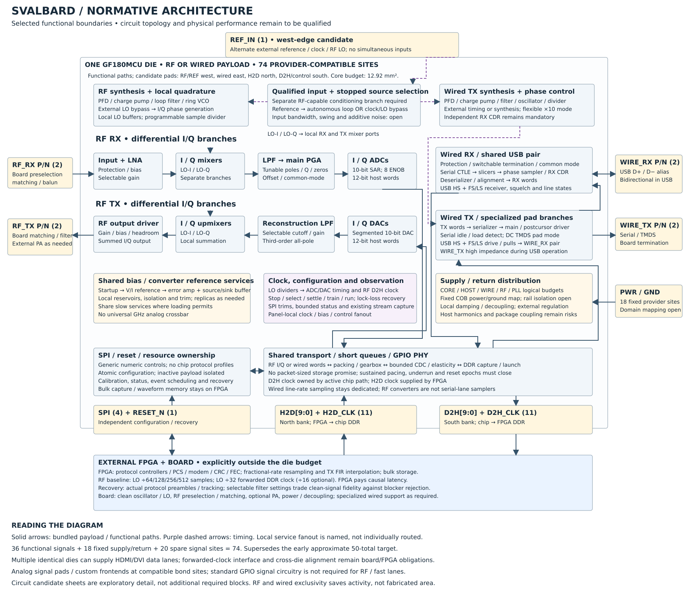

# Svalbard programmable transceiver

**A single-chip, programmable wired-and-wireless transceiver platform.**

Give an FPGA the analog interfaces its ordinary GPIOs are missing: gigabit serial
links, digital-video lanes, and a configurable 2.4 GHz radio. Reuse the same chip
across network interfaces, FPGA peripherals, video bridges, wireless instruments,
and custom software-defined radios by changing its configuration and FPGA logic.

The ambition is one GF180MCU chip in one wafer.space slot, using the provider’s
standard chip-on-board packaging and compatible pad ring. The selected physical
allocation retains 74 provider sites: 37 functional signals, 18 fixed power/return
sites and 19 spare signals. This supersedes the earlier approximate 50-terminal
drawing; electrical qualification of the assembly remains open.
This is an active design: the capabilities below are targets, with partial
mathematical evidence, not demonstrated silicon or certified protocol support.

The [block and connection inventory](spec/analog-architecture.json) and
[block diagram](spec/block-diagram.md) specify the selected implementation.
[Implementation ownership](spec/block-diagram.md#silicon-fpga-and-board-allocation)
puts calibration computation and bulk state on the FPGA, and RF interface
passives on the board; sensitive feedback and sampling stay local.
The current design is addressing coupled analog feasibility and remaining
protocol-level gaps. The [current five-area status](spec/risk-priorities.md#closure-of-the-five-requested-areas)
distinguishes connected model evidence from assumptions and open gates.
Transistor design and physical performance remain unqualified. Historical
mathematical fixtures are not automatically evidence for revised settings.

## What it could enable

| Application | Intended capabilities with suitable external logic | System boundary |
| --- | --- | --- |
| Gigabit networking | 1000BASE-X and SGMII interfaces | FPGA supplies coding, PCS/MAC and link management as needed; this is not a 1000BASE-T copper PHY |
| FPGA peripherals and storage | PCIe Gen1 x1 and SATA Gen1 | FPGA supplies endpoint/controller and protocol logic |
| USB peripherals and hosts | USB 2.0 High Speed, both device and host | FPGA supplies controller; host VBUS power switching/protection is external |
| Digital displays and video bridges | HDMI/DVI, initially 720p60 and 1080p60 at 8 bits/color; DisplayPort RBR, one lane | HDMI/DVI uses three identical lane chips plus an external clock interface; FPGA supplies encoding, control and lane coordination |
| Professional video | HD-SDI at 1.485 and 1.485/1.001 Gb/s | External coax driver/equalizer and FPGA framing/scrambling |
| Wi-Fi and SDR | 20 MHz 2.4 GHz Wi-Fi, including an 802.11ax/HE20 waveform target; custom I/Q radios | FPGA supplies modem, synchronization, FEC and MAC; MCS0–7 interoperability target; coded 64-QAM and ideal-MAC lifecycle evidence, not router interoperability |
| Personal-area and IoT radio | Bluetooth LE, Bluetooth Classic BR/EDR, IEEE 802.15.4 for Zigbee/Thread-class systems, and 2.4 GHz LoRa | External modem/protocol implementation; LoRa here does not imply sub-GHz coverage |
| Custom links and instruments | Proprietary GFSK, intermediate serial rates, selectable RF bandwidth/gain/sample rate, capture and waveform playback | Use generic resources within their eventual characterized operating envelope |

Fractional video clocks such as 74.25/1.001 and 148.5/1.001 MHz are part of the
numeric timing design. Narrower RF settings aim to serve low-rate radios without
forcing every application through a wide Wi-Fi channel. Lower-frequency RF and
other bands through external frequency conversion are stretch goals.

The [selected baseline and decision rules](spec/block-diagram.md#remaining-architecture-choices-closed-for-implementation)
define one current design. The immediate priority is to improve that shared
design until it meets the behavioral requirements. Physical realizability and
fabrication compatibility are subsequent implementation checks; their unresolved
costs remain recorded and are not treated as demonstrated fit.

Current modeling milestone: [one coherent, uncertainty-aware whole-chip model](spec/feasibility-gates.md#current-mathematical-model-milestone),
with explicit capability verdicts and circuit requirements. The model is partial;
individual passing fixtures do not establish whole-chip or silicon feasibility.

## One platform, configurable building blocks

The chip exposes clock, pad, direction, gain, filter, converter and transport
settings—**no on-chip protocol profiles**. Protocol names describe external FPGA
recipes. Dedicated RF and wired frontends share infrastructure where practical.
RF and wired payloads are **mutually exclusive on each die**; both remain part
of the full first-chip design.

A suitable FPGA supplies high-throughput processing and protocol logic, including
CRC/FEC, MACs and endpoints. An MCU can configure the chip and use lower-rate or
buffered functions; GPIO bandwidth determines achievable throughput. Board-level
matching, protection, reference-clock and interface circuitry remain necessary.
**Many external SMD passives are explicitly acceptable.** Matching, filtering,
decoupling and suitable timing networks may live on the board to simplify the
chip; low external component count is not a goal. See the
[external passive allowance](../../docs/roadmap/programmable-transceiver-pin-plan.md#external-passive-component-allowance)
for the pin-budget and modeling boundary.
External oscillators, clock modules and RF LO sources are also allowed operating
options. Autonomous on-chip synthesis need not serve every configuration; input
bandwidth, clock conditioning and terminal allocation must support the chosen
source. See the [clock allowance](../../docs/roadmap/programmable-transceiver-pin-plan.md#external-oscillator-and-clock-allowance).
Narrow temperature and supply ranges are acceptable design targets.

The [normative architecture](spec/block-diagram.md) selects both autonomous and
external timing paths, configurable narrow/wide RF filtering, and FPGA-owned
resampling, TX interpolation and bulk storage. External LO operation reuses
`REF_IN` and still needs a qualified RF input branch. Dedicated wired RX clock
recovery remains necessary. The main diagram shows these selected boundaries;
detailed circuit candidates are linked separately.

The [provisional first-chip baseline](spec/block-diagram.md#provisional-first-chip-baseline)
now makes the implementation choices: external timing first for qualification,
autonomous paths retained, high-impedance clock input, slower RF return clock,
paired SAR/DAC conversion and a tunable finite-zero channel filter. The
[implementation allocations](spec/power-partition.md#provisional-implementation-allocation)
assign rough area and complete-mode current budgets; actual area remains a
layout result. The [capability review](spec/feasibility-gates.md#capability-wide-evidence-gaps-and-next-decisions)
records each target's required circuitry and distinct open proof. These are
current design requirements, not claims that existing
simulations already implement or pass them all.

## Where the design stands

The [open-issue register](spec/risk-priorities.md#open-issue-register) owns the
current blockers and missing proofs. Selected periodic CDR tracking now passes
two acquired-state SSC/gap trajectories at 37.06 and 42.17 ppm against the
50 ppm target, using FPGA-assisted prediction and a finite phase bank. Cold
acquisition, broader jitter/traffic coverage and physical implementation remain
open. Green regression tests do not establish that all capabilities work.

Warm RF hopping now selects stable FPGA-facing timing with a bounded 50 µs
retune/sample-epoch sequence. CDR requirements distinguish incoming offset/SSC
from residual holdover error. RF gain updates have protected command/status
encoding and a complete under-3-µs wideband feedback allocation. These are
selected requirements with component checks, not measured performance.

The [six-finding review](spec/block-diagram.md#review-disposition) now has
explicit design fixes for detection injection, expected silence, USB bursts,
multi-chip alignment, live adjustments and traffic-dependent CDR. Component
checks support the selected mechanisms; complete model/RTL integration and
physical qualification remain unfinished.

Architecture choices are [selected for implementation](spec/block-diagram.md#remaining-architecture-choices-closed-for-implementation):
provider-compatible common returns, external timing/regulation as the primary
qualification route, autonomous timing retained, and LO-derived RF sampling
with FPGA resampling. All application targets remain in scope. Remaining work
must establish one consistent operating envelope, rather than keep alternative
architectures open or infer completeness from passing test counts.

The fast whole-chip behavioral model exercises generic configurations, finite
host queues, RF conversion/filtering, wired recovery and selected lifecycle
behavior. Some target configurations pass their conditional screens; others
still fail. **Full mathematical verification, the complete transistor schematic,
and layout are unfinished.** Passing regression tests also verify expected
failures; they do not mean every target works.

The current design uses differential external clock input, a provisional
0.25 nH shared-return target, external regulation, native 10-bit converters,
and RF sampling derived from the LO. These are modeled requirements and
allocations; their physical implementation is unqualified.

| Area | What the model currently establishes | What remains open |
| --- | --- | --- |
| Shared clock and package | Conditional clock screens accept the 0.25/0.5 nH cases. The adverse package produces input excursions beyond the assigned envelope; independent corners show decoupling ESL improvement alone does not rescue it. | Actual package impedance, input bias/headroom/clamps, leg matching, CMRR and supply-to-delay sensitivity. Clock acceptance alone does not qualify payloads. |
| Complete RF path | Selected fixtures connect conversion, reference-load feedback, filtering and delivered timing. Some diagnostic blocked-signal cases decode; changing feed impedance or internal activity can break acquisition. | One common operating envelope for noise, blockers, gain settling, real preambles, TX spectrum and turnaround. Older narrowband results do not automatically qualify the current design. |
| Wi-Fi 6 preparation | Independent legacy DATA works in both directions at all eight OFDM rates, including return ACKs through retained RF state and finite queues. Candidate DAC/filter/PA assumptions have a conditional combined margin. | Complete HE SU/TB and router lifecycle; select the TX filter with realistic loading/control; qualify DAC accuracy, board power and overload recovery. External-clock candidate current fits the allocation; autonomous current does not. See the [Wi-Fi gate](spec/feasibility-gates.md#wi-fi-he20-capability-gate) for the single current decision record. |
| Wired and FPGA service | Finite queues, causal receiver behavior, loaded-clock TX events and selected restart checks execute. A generic 100 MHz SDR direct stream gives the FPGA 120 ns to decide, with a conditional 342.25 ns USB reply bound including CDC. | Protocol electrical lifecycles, long-run error evidence, physical GPIO service and canonical reply-to-pad integration. |
| Lifecycle and physical fit | The retained RF/wired/USB trajectory joins asynchronous SAR timing, diagnostic selection and delivery, model-observed readiness, fault recovery and FPGA-owned calibration invalidation. | Cold startup, physical sensing and clock acquisition, measured recalibration/correction deployment, serialized fault-service timing and physical fit. |

The [current closure inventory](spec/mathematical-closure.json) retains all
17 intended interfaces. Numerical acceptance requirements and complete
per-capability verdicts remain unresolved. `python3 verification/check_contract.py`
reports these gaps alongside planning arithmetic and source freshness for the
five selected review areas; successful execution is not a chip-completeness
score. A matching source manifest is provenance, not a passing capability verdict.

Use the [model guide](system_model/architecture_fast/README.md) for scoped
commands. `verification/selected_revision_check.py` refreshes selected clock,
wired or RF sections separately; `--input-envelope` is a fast package-corner
voltage diagnostic. Each evidence section retains its own source hashes.
`verification/baseline_envelope.py` contains broader joined experiments,
including historical configurations; neither its filename nor an older report
makes every result current. The [risk review](spec/risk-priorities.md) owns
mitigation decisions and the remaining analog uncertainties.

The immediate priority is [big-picture architecture closure](spec/risk-priorities.md#big-picture-closure-priorities):
reconcile physical/resource budgets, establish one usable analog operating
envelope, close representative full lifecycles, and assess each target against
explicit acceptance criteria. More passing local tests do not replace these
four decisions. Schematic work remains deferred.

The reference-chip investigation has been consolidated into
[explicit assumptions and uncertainty ranges](spec/risk-priorities.md#adopted-assumptions-and-uncertainty-ranges).
Active work now targets connected clock quality, complete RF conversion and
pad/package/power coexistence; further reference-chip simulation is paused.

The [keep-or-change decision](spec/risk-priorities.md#keep-or-change-decision-change-the-delivered-clock-architecture)
keeps the full chip and selects a differential external clock input plus a lower
clock supply-sensitivity requirement. It includes pin/current/area reservations.
The contract, diagram and selected payload clock model use this design;
mathematical verification and physical feasibility remain incomplete.

For the [whole-architecture assessment and keep/change decisions](spec/risk-priorities.md#architecture-assessment-one-implementation-several-ways-to-succeed),
start with the risk review. For current capability status and unresolved failures, use the
[current status table](spec/risk-priorities.md#current-status). Historical
measurements and expected-rejection tests are kept separately in the closure
inventory; their number does not measure chip completeness.

The development order is a connected mathematical model, then a complete
transistor/passive schematic with simulation, then layout and extraction using
the same requirements. Device speed/noise, RF linearity, supply coupling and
package behavior remain major physical unknowns.

## Explore and run



| Document | Owns |
| --- | --- |
| [Architecture and diagrams](spec/block-diagram.md) | Intended blocks and connectivity |
| [Interface and physical plan](../../docs/roadmap/programmable-transceiver-pin-plan.md) | Pin allocation, interface requirements and target scope |
| [Model guide](system_model/architecture_fast/README.md) | Active commands, model coverage and limitations |
| [Risk priorities](spec/risk-priorities.md) | Remaining work in priority order |
| [Closure inventory](spec/mathematical-closure.json) | Formal completion gates and evidence scope |
| [Configuration contract](spec/contract.json) | Machine-readable settings and external test recipes |
| [Operating policy](spec/exclusive-engine-policy.md) | Resource sharing, exclusivity and band stretch goals |
| [Analog workflow](spec/analog-design-workflow.md) | Six-family primitive library, schematic and extraction workflow |
| [Macro contract](integration/macro-contract.md) | Digital/analog boundary and RTL obligations |
| [Consolidation audit](docs/consolidation.md) | Documentation ownership and recovery of historical evidence |

From the repository root, run the active behavioral regression:

```sh
make transceiver-behavioral
```

See the model guide for optional checks. Model code lives in `system_model`,
checks in `verification`, incomplete circuits in `analog`, digital implementation
in `rtl`, `sim` and `integration`, and reports in `evidence`.
