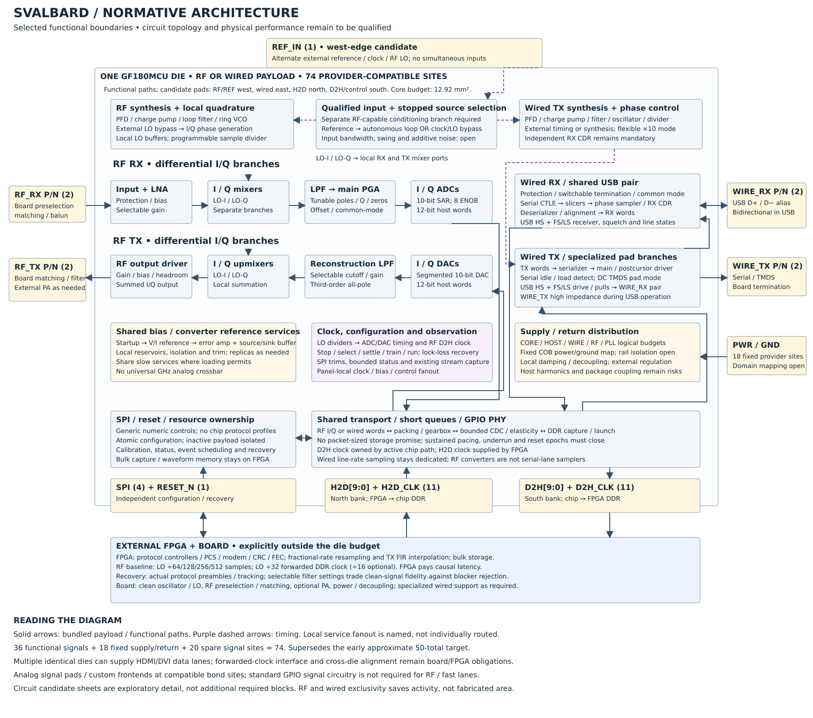

# Normative whole-chip architecture

[Full-chip SVG](../docs/diagrams/transceiver-block-diagram.svg) · [PNG preview](../docs/diagrams/transceiver-block-diagram.png)

This document explains the selected functional architecture in
[the authoritative inventory](analog-architecture.json). “Normative” specifies
what the design must implement, not demonstrated silicon performance or a completed
transistor implementation. The drawing places RF west, wired east, timing north and host
logic south, with terminals at the perimeter. Neighborhoods are intentional;
block areas and routes are not a physical fit result.

See the [decision gates and operating ledger](feasibility-gates.md#decision-sequence-several-credible-ways-to-succeed) for the packaging-first closure sequence.

The [whole-architecture assessment](risk-priorities.md#current-architecture-decisions) records the cross-system conflicts, operating sequences and every interface family’s open gate.

## Silicon, FPGA and board allocation

The inventory's `implementation_ownership` is the selected boundary. Keep all
37 signal assignments, 18 fixed supply/return sites and 19 spare signal sites;
this review adds no pins. Spare sites are not evidence that sensitive nodes can
be routed off-chip successfully.

| Function | Selected owner and reason |
|---|---|
| Calibration search, stored trim tables, I/Q and converter correction | FPGA; chip supplies observations and numeric trims with atomic application. No on-chip optimizer or persistent calibration database. Analog offset cancellation remains local to preserve headroom. |
| Channel selection FIR, decimation, interpolation, AGC and hop policy | FPGA; retain the existing causal gain and hop deadlines. Analog filters still prevent overload, aliasing and DAC images. |
| RF matching, baluns, preselection and harmonic filters | Board, at existing RF terminals. Include insertion loss, blockers and driver load in the complete chain. |
| Bulk supply capacitance and feed filtering | Board; retain local 1 nF supply allocation and 100 pF converter reference reservoir. Bond inductance prevents treating remote capacitance as equivalent local capacitance. |
| Wired coupling and TMDS sink pullups | Board where the selected interface requires them. USB switchable termination and FS source resistance remain local. |
| PLL/CDR filters, quadrature, converter sampling and reference buffer | Silicon; exporting these internal feedback/sampling nodes adds parasitics and pickup to the hardest timing and signal-quality paths. |
| Serialization, USB burst capture/turnaround, fault isolation | Silicon; FPGA owns policy and packets, but host round trips cannot replace these timed physical actions. |

Externalizing both PLL filters would require at least two signal sites for
single-node filters, plus suitable return routing. As a sensitivity example,
2.7 pF of pad capacitance is 27% of the selected 10 pF loop capacitor, before
PCB capacitance. This is not a qualified pad model or proof that an external
filter fails; there is insufficient advantage to select it. Keep both filters
local and use the existing external differential clock route when internal
clock quality is inadequate.

A differential I/Q filter insertion requires at least eight extra signals per
RX or TX chain; moving both would consume 16 of the 19 spares, before guard and
return requirements. New drivers would have to charge board loads, with their
noise, current and settling included. Keep these filters local. FPGA filtering
cannot undo pre-ADC clipping or aliasing, and digital correction cannot remove
random phase noise.

For scale, an illustrative 1 nH connection has reactance 0.63 ohm at 100 MHz
and 15.7 ohm at 2.5 GHz; a 1 nF remote capacitor with that inductance resonates
near 159 MHz. These are lumped sensitivity examples, not measured assembly
parameters, and omit resistance and distributed effects. No board-passive
change earns die-area savings without proving the complete impedance path.

This allocation clarifies ownership rather than claiming removal of fabricated
circuitry. No area/current saving is credited for functions already external.
Full calibration observability, FPGA timing and board implementation still need
qualification; the ownership decision does not demonstrate those functions.

The shared RF chain now has an explicit [Wi-Fi interoperability allocation](feasibility-gates.md#wi-fi-he20-capability-gate):
MCS0–7 quality with margin, external-frontend costs, antenna-time response
budgets and equipment/FPGA-owned calibration. No new pins or Wi-Fi-specific
blocks are selected; complete exchange and wider-filter qualification remain open. A generic48bit
sample counter, protected launch/snapshot descriptors and192bits of runtime
state now specify converter-edge scheduling. FPGA calibration translates those
edges to antenna time; wired video alignment is unchanged.

## Current protocol-closure work

The [analog inventory](analog-architecture.json) is the only normative design.
Connections, controls, resources and this diagram are updated together; prior
design states belong in Git history. The six review findings have selected design mechanisms and scoped checks;
physical qualification and complete model integration remain open. Model reports retain evidence
provenance, not alternate normative design definitions.

The PCIe-style generic receiver-detection path is now an explicit paired current
net from `detect.test_current` to `txpad.test_current`, behind the protected TX
pads. The pad selector has a dedicated detect state. Normal serial/TMDS output
stages and source termination must be off before enabling the test source;
threshold crossings and timeout terminate injection. RX/USB pads are not driven
by this path. Current is nominally 100 µA per leg, programmable 50–150 µA,
within the existing detector current allowance. This specifies connectivity and
ownership; the load-detection transfer and thresholds still need qualification.

Normal line silence now has its own receive-state policy. An independent
physical quiet observation or HS squelch closes RX validity without resetting
the stream epoch or stopping the other direction. Initial acquisition, valid
tracking, bounded holdover, dropped bursts and unexpected loss are distinct.
Quiet never masks reference/supply failure, and bounded host-requested quiet
cannot be extended indefinitely. The FPGA retains protocol parsing/timeouts.

The executable control-state requirement is
`system_model/architecture_fast/receive_qualification.py`; its inputs are
physical level/phase observations. Tests exercise lifecycle semantics, not
analog acquisition speed. Integration into the complete physical/behavioral
receive chain remains separate from those policy tests.

The review disposition below distinguishes design fixes from their remaining
implementation and physical qualification obligations.

Live current/pre-emphasis changes are now permitted during an explicitly armed
generic training window. Current and postcursor shadow values commit atomically
at a serializer-word boundary; termination changes remain stopped-only. The
chip reports applied and settled word indices while training data continues,
without electrical idle insertion, PLL restart, FIFO reset or epoch change.
The selected transition budget is 16 line UIs, rounded up to a word boundary
for settled acknowledgment; this is an analog settling requirement to qualify.

Cold-start qualification and warm RF direction changes have separate guards.
Startup uses management-clock qualification ticks (at least 20 µs by default).
RX→TX and TX→RX use independent H2D-derived guard fields, default 32 ticks or
819.2 ns in H0; gain settling defaults to 8 ticks or 204.8 ns. Actual filter and
board-switch settling can require longer guards. A late launch stays muted,
rather than being silently delayed. Warm operations preserve clocks and epoch;
missing startup readiness is rejected, not hidden inside a fast action.

`system_model/architecture_fast/live_control.py` checks field permissions,
atomic boundary timing, stale/late rejection and guard separation. Its tests do
not establish physical slew, settling or end-to-end protocol response time.

## Burst phase acquisition and early history

The wired slicer now includes eight gated parallel acquisition samplers in
addition to its tracking phase bank. Each acquisition sampler runs at the
line rate with a different phase; no 8× clock is assumed. This mode is limited
to 480–640 Mb/s and uses the retained reference-assisted CDR oscillator.
A 32-UI circular buffer continuously records all eight phases while armed,
including activity onset. The allocated 512 bits cover 256 sample bits plus
activity/index/replay state. Packet recognition and CRC stay on the FPGA.

Acquisition collects eight UI and selects a phase with a required margin from
observed transitions; ambiguous or insufficient evidence drops the burst.
Historical selected-phase bits replay at up to two bits/UI into the existing
raw-record queue. Monotonic bit indices and a phase-seed acknowledgment define
the handoff to live tracking. Overflow must report failure, not overwrite an
unread packet prefix. The selected pad-activity-to-phase-decision budget is
16 UI, including detection and handoff; early samples remain available even
when acquisition extends past a shortened preamble.

`burst_acquisition.py` exercises parallel sample selection and ordered history
replay over input phase and assigned edge jitter. It does not yet qualify
metastability, frequency tracking, physical handoff or full port response time.
The sampler expansion reserves an additional 0.16 mm² and 4 mA in USB mode;
no extra pad or protocol engine is introduced.

For response-critical operation, the clock tree can forward the conditioned
H2D clock as D2H timing instead of deriving it from the unrelated line PLL.
This uses an existing pin and supports the selected 100 MHz SDR host service
while the line runs at 480 Mb/s. Selection occurs while stopped. Input/output
buffer delay and FPGA capture phase require qualification; host-clock loss
cancels pending actions. The selected fast service below owns the response budget.

## Warm RF hopping and gain feedback

The shared configuration selects this path with
`host_clock_source="h2d_divided"`. It resolves the D2H word rate from the H2D
physical clock, while the converter rate follows the selected LO/sample divider.
`WarmHop.from_configuration` and `begin_configuration` reject a changed host
clock, a different design or a direction change disguised as a hop. The next
configuration becomes active only after the epoch/readiness/launch sequence.

Frequency-hopping operation selects a stable RF host clock: H2D at 156.25 MHz,
D2H at H2D/2 = 78.125 MHz DDR. Converter sampling remains LO-derived, with FPGA
resampling. Host clock selection is stopped-only; once selected it stays fixed
through hops. A hop changes the **sample epoch**, not host word alignment, so it
requires neither GPIO capture retraining nor a new transport session.

The current warm-hop allocation is 50 µs: 1 µs mute/queue barrier, 35 µs external
source settling, 4 µs source qualification, 5 µs converter/filter/gain settling,
2 µs sample-epoch acknowledgment and 3 µs prefill/direction guard. Preload next
frequency/gain context before this interval. Keep the full channel table on the
FPGA; only current/next state lives on chip. The selected external LO must support
preloaded frequency changes within its assigned bound; a generic fixed oscillator
does not meet this requirement. Autonomous saved-context hops must independently
meet the same bound; exhaustive tuning searches remain startup operations.

Mute/isolate converters and flush their FIFO epochs before changing clocks.
Expected LO loss is permitted only inside the bounded hop state; supply or host
clock loss still faults. After source qualification, renewed source loss faults.
Only a new-epoch acknowledgment plus settled converters and prefetched TX data
allows launch. Late readiness cancels the scheduled air operation. The FPGA must
admit the full sequence against its actual packet/slot schedule; a 50 µs sum is
not proof of every Bluetooth schedule. Representative schedule checks admit the 68 µs discovery ID within a 312.5 µs
interval and a conservative 2916 µs BR packet within five 625 µs slots, including
a further 5 µs uncertainty reserve. The FPGA must still admit every scheduled
operation; an occupied slot is not a free retune interval. BLE same-channel replies
use warm direction changes, while event/channel changes use this full hop path.

RF gain feedback is also a complete round trip: observe 16 samples, return them
through up to three dense frame periods, make the FPGA decision, send the gain
command through up to three frame periods, cross/commit controls, settle and
resume clean samples. With at least 37.5 MS/s, 156.25 Mword/s D2H, 312.5 Mword/s H2D,
150 ns frontend latency, 100 ns decision and 400 ns analog settling, this allocation is under 3 µs.
The 204.8 ns gain-guard reset value is not the complete loop latency. Narrowband
filters and overload recovery require their own longer settling bounds.
The protected RF-only opcode4 carries atomic LNA and matched I/Q PGA indices;
its returned status identifies the gain boundary and invalid/discarded sample
pairs. A bounded one-pending-command path reserves status priority. The next
frame starts fresh I/Q packing, so old/new gains cannot be silently mixed.
`rf_gain_command.py` owns the command/status encoding and rejects corruption,
stale sequence and wrong ownership. Legacy RTL still needs this operation.

Admission includes actual training time: two under-3-µs updates can fit an 8 µs
window with 2 µs reserved, or one in a 4 µs window with 1 µs reserved. Longer
settling can invalidate either case. Narrowband packets use their actual longer
training and filter bounds. These are latency allocations, not proof that the
modem acquires at a given signal strength.

`timing_services.py` checks hop readiness/epoch/fault sequencing and the complete
gain budget. Source-settling and filter delays are explicit assumptions, not
predicted silicon performance. The normative details are `warm_hop_service`
and `rf_gain_feedback` in the inventory.

## Frequency offset and spread-spectrum recovery

The CDR must acquire incoming offsets from −6000 to +1000 ppm relative to the
selected nominal rate, with local correction headroom of ±10000 ppm. Nominal
rate endpoints do not clamp actual clocks: oscillator, divider and pad electrical
qualification must cover the corresponding frequency margin.

The selected tracking screen covers 0 to −5000 ppm triangular downspread at
30–33 kHz plus static offset within the acquisition envelope. The loop requires
frequency-integrating correction and qualified phase/frequency observations;
a phase-only sampler or a static fractional divider is insufficient. A received
spread-spectrum clock does not imply the chip must generate that modulation.
Qualified external/common timing may supply TX where appropriate.

The 50 ppm holdover figure is **residual recovered-frequency error**, not the
incoming-clock tolerance. Missing-transition budgets must additionally integrate
frequency slew. At the selected 330 million ppm/s slew bound, long holdover can
fail even when it passes a constant-frequency calculation. SDI and SSC links
therefore cannot share an unexamined timeout setting.

The linear type-II tracking screen in `timing_services.py` checks the selected
rates and loop bounds and exposes a too-slow loop failure. It starts already
frequency-acquired; it does not qualify detector nonlinearity, acquisition,
metastability, quantization or physical jitter. See `cdr_tracking_requirements`
and [TI clocking guidance](https://www.ti.com/lit/an/snaa386/snaa386.pdf).

## Host interface selection

Keep direct byte streaming for response-critical bursts and dense framed
transport for sustained wired/IQ traffic on the same pins. Byte-only operation
cannot sustain the 2.5 Gb/s lane with overhead at the selected host-speed ceiling.
The [format decision](streaming-transport-v2.md#interface-format-decision) records
the capacity comparison. SPI remains independent configuration/recovery.

## Selected response-critical host service

USB uses a **generic direct raw-byte stream at 100 MHz SDR** on the existing
10-bit H2D/D2H buses. The FPGA receives eight raw line bits per data beat and
updates its NRZI, bit-stuffing and CRC logic as they arrive. It has **120 ns
(12 cycles)** after the final capture to validate and choose a reply. Bulk
storage, packet encoding, protocol decisions and CRC remain on the FPGA.

Each word contains eight payload bits, a data/control flag and even parity.
Control codes are IDLE=0, START=1, END=2, ABORT=3; 0x11–0x17 declare 1–7 valid
bits in the next partial data beat, followed by END. Codes 0x40–0x5f carry
cumulative modulo-32 FIFO credit returns. Data bits are chronological, LSB first.
Parity/order/padding faults invalidate the stream; parity is not link ECC.
Mode changes are stopped-only and require shared epoch reset/training.

This bypasses framed transport's whole-frame waits. Existing small FIFOs carry
bytes across domains: RX consumes at 100 MHz; TX uses a simple local divide-by-two
of the 480 MHz serializer clock for a 240 MHz FIFO/gearbox consumer. Two pointer
synchronizer edges plus a consumer edge remain explicitly priced. The TX path
waits for four bytes before launch; subsequent bytes stream under eight-entry
credits. Credit returns take at most four host cycles. The FPGA must always
accept RX; USB direction exclusivity leaves D2H available for credits during TX.
No new pins, protocol engine, PLL or packet RAM are required.

The complete assigned response bound is **342.25 ns against 400 ns**, leaving
**57.75 ns** with the 120 ns FPGA allowance. It includes the 8-UI receive tail,
byte packing, quiet qualification, ordered partial/END beats, both CDCs, FPGA
capture, START plus four-byte prefill, launch phase, 16 ns output settling and
20 ns board allowance. USB uses an 8-UI minimum reply gap, independent of RF and
startup guards. Readiness/initial credits are established before the transaction.
Host/reference loss or underrun cancels output; no stale or delayed reply.

`verification/usb_selected_timing.py` exercises actual incoming DATA, streaming
FPGA-side CRC validation, causal reply selection, finite CDC, serialized credit
returns and ACK playback across 240 clock-phase pairs. Long transfers exercise
backpressure and producer stalls. The source-side sampling tail and analog
settling remain assumptions; FPGA synthesis and canonical model/RTL integration
are unfinished. This is a conditional feasibility improvement, not compliance.
The detailed machine-readable owner is `analog-architecture.json:direct_stream_service`.

FPGA integration is streaming hardware, not an interrupt handler. While receiving,
accept every beat and update the raw-bit parser/CRC in parallel; keep payload
storage and candidate reply bytes locally. At END, use the assigned twelve-cycle
window to finalize CRC, check endpoint/buffer state and choose whether to reply.
Then send START and four bytes promptly, continuing under credits. Bad CRC means
no START. The model exercises this causal ordering but does not prove a particular
FPGA implementation meets 100 MHz. For USB host back-to-back scheduling, the FPGA
retains the distinct required gap; this 8-UI guard is for replies to received packets.

The retained 8–192 UI local response target comes from USB-IF
[electrical compliance guidance](https://www.usb.org/sites/default/files/USB%202%200%20Electrical%20Compliance%20Specification%28v1.07%29.pdf),
EL_22. No hub or cable deadline extension is used.

## Review disposition

| Finding | Selected fix and executable evidence | Remaining qualification |
|---|---|---|
| Receiver-detection injection | Explicit `RX_DETECT_INJECT` net and exclusive TX-pad detect branch; generator checks connectivity and selector. | Test-source compliance, pad transient and detection thresholds. |
| Expected silence | Independent quiet/squelch observation and distinct acquisition/tracking/holdover/drop states; `test_receive_qualification.py`. | Joined analog observation latency and complete supervisor integration. |
| USB burst reception/response | Eight-phase sampler history, acknowledged phase seed, ordered replay and direct host service; `test_burst_acquisition.py`, `test_usb_selected_timing.py`. | Metastability, offset/tracking, real packet acquisition, full-chip/RTL integration and physical turnaround. |
| Multi-chip video | Qualified divider/serializer release, common marker/epoch, fixed pipeline and bounded compensation; `test_video_alignment.py`. | Actual capture aperture, phase release, pipeline and connector skew. |
| Live training/RF turnaround | Atomic word-boundary swing/postcursor updates; separate warm direction/gain guards; `test_live_control.py`. | Analog settling and end-to-end deadlines. |
| Traffic-dependent CDR | Numeric transition-gap/phase budget, continuous-stream quiet policy and external SDI baseline restoration; `test_receive_qualification.py`. | Pathological waveform, baseline-wander and jitter qualification. |

These fixes close the review's missing design definitions. They do not establish
silicon performance, protocol compliance or completion of the whole-chip model.

## Deterministic multi-chip launch

Use the shared differential forwarded word reference with integer ×10 line-rate
synthesis (×20 then ÷2 where needed to stay in the VCO range). All dies lock and
qualify divider phase before launch. A 64-reference-cycle phase-window check
with a selected 0.0625-UI phase-error target is allocated within the clock tree;
it is not a claim of achieved PLL phase accuracy.

After prefill, arm every muted die with the same epoch and launch count. The
FPGA broadcasts a rising SPI_SCLK edge while every SPI_CS_N remains high; the
conditioned edge has a direct internal path to clock-tree epoch logic, independent
of SPI command buffering. The board must guarantee at least 2 ns setup/hold
relative to the intended reference capture edge at each die. The edge is a
one-shot marker; ordinary SPI transactions are forbidden during this armed
interval. No new pin or PLL reset is required.

The marker establishes common divider/serializer word zero. Each die starts
bit zero at the selected reference count, followed by a fixed 8-UI pipeline and
programmable 0–3-word plus 0–9-bit delay. Compensation is bounded to 39 UI;
larger mismatch rejects the group. Board reference fanout adjustment owns
sub-UI static correction. The selected residual connector-skew target is
0.25 UI, including uncertainty, and still needs physical qualification.

The shared video configuration uses `clock_source="forwarded_word"` and the
actual fractional pixel reference. Line rate is the selected ×10 ratio;
output divider is chosen from the inventory to keep the VCO in range. Host
word timing follows the synthesized line clock, not the input pixel clock.
`ConfiguredLaneClock` retains its sampled PI/VCO state through source loss and
recovery, observes the inventory phase window for 64 reference cycles and
requires the selected 20 us settling guard. The PI reduction is an explicit
behavioral assumption, not charge-pump circuit qualification. The direct-clock
payload adapter rejects this topology rather than relabel a pixel clock as a
serial clock. `configured_forwarded_clock` joins the same differential input,
pad/package and host forcing to finite threshold-edge windows and the retained
PLL. Fractional frequencies are neither rounded nor replaced by a repeating
integer-Hz clock. The low-frequency source recipe uses 0.5 V differential peak;
1 V is retained as a failing input-envelope control. Source-noise perturbation
and reference-presence observation remain explicit model assumptions.

`ConfiguredVideoStream` consumes framed FPGA symbols using actual synthesized
clock phase, the shared ingress allocation, assigned two-host-cycle plus one-
consumer-cycle CDC, 32-word prefill and eight-UI launch pipeline. Three retained
lanes are exercised through streaming, one reference-loss event, a delayed FPGA
stop, explicit FIFO/epoch recovery and a new common launch. The same PLL and
FIFO objects survive; only the explicit recovery command flushes queued symbols.
Underflow, overflow, stale epochs and malformed clock events reject output.
This is opaque-symbol clock/transport continuity; TMDS encoding and connector
pad transients remain separate acceptance obligations.

The selected CDR uses a 96-bin finite phase detector: 97 local boundary
samples plus DATA, with the separate gated burst-acquisition bank retained.
The encoder rejects missing brackets and nonmonotonic codes; no transmitted
labels or exact channel-crossing timestamps enter feedback. Its 128-phase
observation grid spans 0.75 UI. Feedback gains are 0.04 (phase), 0.0003
(frequency) and 5e-7 (frequency slope). Actual commands use 1 ppm period
steps and a 4096-step phase grid, including carried rounding residue.

`cdr_periodic_tracking` is an optional generic serial receive configuration,
not a protocol profile. Ordinary reception keeps a 1024 UI acquisition timeout.
Periodic acquisition permits 1,000,000 UI and reserves the existing framed
host service without changing its clock or epoch. The FPGA stores 128 local
observations (1280 bytes), fits the periodic clock using 96, and validates on
32 withheld observations. The model charges 32 us computation and bounded
framed observation/coefficient transport. Two frame intervals are reserved in
each direction; actual configured host rates determine latency. The 64-byte
fixed-point coefficient command reuses the ingress FIFO; observations reuse
egress. The command becomes active atomically, only followed by readiness
after a fresh local validation. A mismatch invalidates reception. Once periodic prediction is active, it owns
slew; the ordinary noisy slope integrator is disabled. Phase and frequency
feedback remain active for residual correction.

The unchanged tracking targets are 50 ppm and 0.0625 UI. A passing acquired-state
trajectory does not establish cold acquisition, changed modulation, arbitrary
slew, actuator delay or a complete jitter mask. The 125 ppm internal holdover
allocation remains distinct. Required detector noise is 0.5 ps RMS and supply
sensitivity is 0.0025 ps/mV with a 1 GHz pole. The 96 ps CTLE pole is retained.
Sampler/encoder current, loading, area and the fine actuator are implementation
obligations; the old resource allocations do not prove this larger bank fits.
The coefficient transport is a bounded service model, not a completed wire ABI.

The FPGA observes arm/capture/phase/launch status and calibrates actual lane
latencies; reported equal epochs do not prove physical skew. Missing prefill,
clock loss or a missed launch count must not silently shift a lane's launch.
Continuous operation uses the common average word rate and bounded FIFO service.
Receive alignment remains independent CDR plus finite FPGA character/word deskew.

`video_alignment.py` checks common capture edges, bounded integer/fractional
compensation, epoch/readiness, late launch and uncertainty. Its fractional
compensation is explicitly a board obligation, not an assumed on-chip delay
line. Physical capture and deterministic clock release remain circuit targets.

RF output board design must preserve the existing programmable driver-gain range
and allow characterized external matching. Signal-bond loop inductance is a
separate parameter from supply-return inductance. The current lumped output
screen finds conditional gain-trim paths for low-inductance routes and an
external series-compensation path for a larger-inductance hypothesis. One compensated waveform case now reaches0dBm with the assigned gain/current/
headroom/quality model, but no matching value or package performance is physically
qualified. Keep the0dBm acceptance gate open across component and operating
uncertainty; increasing the software gain setting is
not sufficient evidence.

The board shall provide replaceable RF matching components and access for output
characterization. Select matching once per assembled board/band, then use the
existing driver gain for power calibration; channel-by-channel component changes
are not assumed. A fixed nominal capacitor is not the default robustness strategy.
The assigned tolerance screen favors per-board matching adjustment, but its ±2%
residual tuning error is a measurement requirement to validate, not demonstrated
assembly accuracy. This adds no die pins, blocks or storage. Maintain the current
0 dBm target; do not count an optional external PA as proof of chip output power.

Keep the existing RF driver and board matching route for the mathematical
architecture. The current high-power configuration candidate requests gain6.3
(resolved6.2941 on the existing8-bit control), with250 RMS transport codes and
external matching. A joint screen at2.426GHz,8nH signal-loop inductance and
0.538pF matching sampled at−10%, nominal and+10%, with doubled assigned cubic
distortion, delivers respectively+0.553,+0.829 and+0.920dBm. All three meet the
sampled mixer, driver voltage/current and energy guards at the234mA chip
allocation. Peak driver current is24.20mA or less against28mA bias; conservative
voltage margin is only73mV. Retain the lower reset gain and calibrate operating
gain externally; the higher setting is not a new default or a protocol profile.
This supports retaining the block set, not freezing its physical realization:
the model applies distortion before scalar gain, and sampled matching values do
not bound the continuous tolerance region, all channels, output noise, emissions
or gain-dependent bias and compression. The evidence is
`selected-revision-check.json:tx_gain_matching_uncertainty`.

Shared-pad owner changes must release local drive, disconnect the previous
functional branches, wait a bounded break-before-make interval, then connect the
new branches with output drive still released. External drive and stored pad/
divider charge persist during this sequence. Reset disconnects local functional
branches; it does not remove external voltage or the protection network. The
connected behavioral sequence includes command latency and the isolation interval;
its illustrative 2 ns latency and 3 ns dead time are hypotheses, not circuit
specifications. Finite charge-pulse hypotheses now cover switch injection in the
connected pad/divider model; measured charge, edge skew and slew still need bounds before
admitting transition voltage stress or protocol response timing. Active remote
sources must be modeled independently of the locally selected pad mode.

USB HS current calibration must use the actual assembled-board rail and load,
with the existing numeric current trim. A nominal current-source amplitude at
3.3 V cannot qualify operation after package/feed voltage drop. Include source
output resistance and supply-to-current coupling alongside compliance headroom;
check delivered voltage throughout the response, not just successful decoding.
The connected model exposes these parameters as hypotheses; measured ranges and
reference dynamics remain circuit-validation obligations. No extra trim hardware
or on-chip protocol control is allocated by this requirement.

Analog readiness must distinguish a current valid observation from a stale held
flag. Declare the observation cadence and maximum age for each modeled monitor;
a gap restarts qualification and must not allow traffic to continue on old data.
The model supports this freshness contract and output release on expiry. Actual
sensor thresholds, cadence, aggregation and implementation costs remain open;
no new watchdog register or physical monitor is implied by the model API.
The existing management-clock supervisor must continue observing required
supply, reference and bias validity while both RF payload directions are muted.
Its ready inputs must not freeze with converter or serializer activity.
Selected numerical coverage uses a 100 ns observation period and 200 ns maximum
age; these are unqualified monitor requirements. The ownership runner supplies
independent observations through the warm settling gap, using read-only
reference recovery and current supply. Completed conversions own observations
during active RX so the idle observer does not substitute an unloaded reference
for an in-flight SAR. Disabling independent observations rejects turnaround;
with them the scoped seven-stage lifecycle completes. Sensor dynamics, loading
and bias/filter settling still need their own qualification.

## Traffic-dependent receive timing

Receive qualification budgets local aperture movement, observation uncertainty,
residual frequency and source slew together. The selected local supply sensitivity
is 0.0025 ps/mV; external reference jitter does not substitute for this requirement.
The phase-bank controller uses a 125 ppm internal residual allocation. The
separate 0.0625 UI and 50 ppm targets are scored independently; a quarter-UI
holdover pass alone cannot satisfy them.

At runtime the receiver preserves uncertainty through missed phase brackets and
adds residual drift, aperture movement and integrated slew before admitting a
returning transition. The slew term is
`0.5 * slew_ppm_s * 1e-6 * gap_UI**2 / line_rate`.
The selected 512 UI setting must fit the quarter-UI bound; extending a counter
cannot create phase margin. The primitive's 64 UI reset is retained only for
independent fixtures; the design-bound receiver resolves its setting from the
shared inventory. Cold acquisition and oscillator/actuator settling require
additional evidence beyond the acquired-state diagnostic.

Holdover verification must also integrate measured phase drift through complete
transition gaps, including SSC and actual aperture displacement. Check interior
sampled extrema and the returning-transition sample, adding the last detected
phase-error allowance and uncertainty reserve. This independent fixture audit
must never supply source timing to the CDR or its readiness policy. A passing
short gap does not establish the constant residual-frequency target; a failed
long gap requires better tracking or a restricted numeric gap configuration.

For HD-SDI, select continuous-stream quiet policy and DC coupling from a
compatible external equalizer output, with required baseline restoration owned
by that external interface. The chip's CTLE retains DC response. If AC coupling
is used instead, its baseline wander must be included in the voltage-eye budget;
phase holdover does not repair it. Qualification requires both unequal-occupancy
and sparse-transition pathological streams, followed by normal data recovery.
These requirements are recorded in `cdr_traffic_requirements` in the inventory.

## Analog controls and ownership

The inventory's `control_fields` defines all analog control endpoints (with widths accounted in the inventory), including per-block off/warm/active requests. These are
internal control signals, not extra pads or a new external protocol. Each field
has a width, reset value, range or enumeration and update rule. `control_calibration`
defines the numeric trim mappings; disabled reset coefficients are not a
calibrated operating recipe. Register addresses remain a digital implementation
mapping, not analog connectivity.

`operating_modes` assigns every block an activity envelope. RF and wired
payload remain exclusive; simultaneous wired RX/TX is retained. Same-channel RF
direction changes preserve clocks and epoch. `mode_transitions` defines startup,
settling, direction changes and fault recovery; faults dominate all scheduled
output enables. Source-dependent PLLs run only when selected.

The USB FS/LS output resistance is selected as 43 Ω inside its isolated driver
plus the 2 Ω branch switch. No permanent external FS-only series resistor is
placed on the shared HS pair. The resulting 45 Ω is a design target requiring
trim and electrical qualification, not a measured pad impedance.

## Selected resource allocation

Every inventory block now has an area ceiling and a current budget for each
operating mode. These are implementation requirements, not extracted results.
The allocations preserve the 12.92 mm² core envelope, including the 0.85 mm²
memory allowance. Power distribution and 1 nF supply decoupling consume
1.30 mm² of the 2.61 mm² reserve, leaving 1.31 mm² unassigned reserve.
The 100 pF converter-reference reservoir is separate and charged to its buffer.

With provisional2mA-per-DAC support included, primary external-clock RF is
234mA; the five-pole filter candidate earmarks4mA per filter and raises this to
240mA against the unchanged240mA ceiling. Autonomous RF is245.9mA before that
candidate and remains outside this planning envelope. These source-specific
allocations are not physical power qualification. Other mode totals are272.45mA for
simultaneous serial RX/TX, and 252.2 mA for the USB activity envelope. Source and
output-branch overrides explicitly replace the relevant currents: TMDS replaces
the serial TX driver, and external timing disables its unneeded PLL. These
figures do not qualify current, thermal behavior or the package. Historical
joined simulations retain their original power ownership; the design assigns converter
current to the explicit CONV branch rather than hiding it within CORE.

Supply monitoring covers RF, WIRE, PLL, CONV, CORE and HOST independently.
The HF clock conditioner supplies both the undivided clock and a selectable
÷1..256 acquisition reference; choose the divider to keep that reference within
10–250 MHz. This avoids requiring an unavailable second clock input for CDR.
Detector timing has an explicit 250–500 MHz clock branch, separate from the
50 MHz management oscillator and H2D-derived action scheduler.
The clock inventory specifies actual branch rate ranges, and the host-divider
configuration must satisfy both GPIO clock limits and sustained transport demand.

## Differential external clock architecture

The [keep-or-change decision](risk-priorities.md#current-architecture-decisions)
is implemented in the contract, diagram and selected payload clock model.
`REF_IN` is the positive leg and `REF_IN_N` the negative leg of one differential
reference/LO port. The 0.025 ps/mV aggregate supply-delay target remains an
unqualified physical requirement. Historical single-ended studies retain their
original provenance and are explicit controls, not evidence for the current design.

## Provisional first-chip baseline

This is the selected architecture for the next whole-chip mathematical model,
not a silicon-performance claim. Keep all requested application targets. Prefer
externally assisted operation for initial qualification while still fabricating
the autonomous timing paths. Do not require an autonomous oscillator to pass
before evaluating the rest of the chip, or remove it merely because an external
source works.

| Boundary | Selected baseline | Alternative and its cost |
|---|---|---|
| Assembly and pins | Provider-compatible 1×1 COB geometry, all fixed supply/return sites retained; 37 functional signal assignments, analog/custom fast signal cells | No custom-package escape is assumed. The provider has 74 sites; 37 signals plus 18 fixed supply/return sites already require 55 assignments. The earlier approximate 50-total target is superseded by this provider-compatible physical allocation; the 51-entry logical model is not the bond map. |
| RF chain | Differential RF input/output, two RX mixers, two channel filters/PGAs, two ADCs, two DACs and two TX reconstruction/upconversion branches; one summed output driver | RX/TX bias reuse can reduce active current, but both paths occupy area. ADC/DAC sharing that interrupts timely turnaround is not selected. |
| RF selectivity | Reserve a tunable fifth-order channel-filter realization capable of finite transmission zeros as well as the existing all-pole control response | The elliptic transfer function is a candidate setting, not a fixed topology. Q/zero tuning and internal headroom must fit the filter allocation. Higher ENOB is a costed alternative, not the default cure for blocking. |
| Wired chain | One independent RX CDR/deserializer and one TX serializer/driver; simultaneous wired RX/TX allowed | Do not replace the CDR with ordinary FPGA GPIO sampling or borrow the RF ADCs as line-rate samplers. |
| Specialized electrical branches | USB HS plus FS/LS and independent pulls/termination/sensing on WIRE_RX; idle/detection and DC TMDS capability retained on the wired frontend | Disabled-branch capacitance counts against serial bandwidth. External AUX, cable interfaces and USB VBUS support stay outside the chip. |
| RF clocks | External 2.4–2.500 GHz LO through the dedicated REF_IN analog branch is the first qualification route; autonomous RF synthesis remains fabricated | One differential REF_IN/REF_IN_N port, selected while stopped; no simultaneous independent reference and LO inputs. A fixed sample-clock alternative needs a real extra source and CDC allocation before adoption. |
| RF conversion/host rates | LO ÷64/128/256/512 conversion; start with LO ÷32 physical D2H clock, hence LO ÷16 DDR words. H2D remains 156.25 MHz clock / 312.5 Mword/s | The faster LO ÷16 D2H clock is an optional higher-switching configuration. The selected slower return path needs bounded service gaps and FPGA resampling. |
| Wired clocks/host | TX synthesis or external timing as appropriate; RX has independent recovery. Up to 312.5 Mword/s on each ten-bit host bus | Incoming recovered data crosses a bounded queue; continuous rate matching and recovery remain required. Multi-die TMDS needs shared board timing and alignment. |
| Shared services | One control/transport owner, shared master bias with local reference buffers/reservoirs, local clock branches; RF and wired payload exclusive | Share slow sources and reusable circuit designs, not a universal RF/serial switch fabric. Inactive leakage and quiet detection remain budgeted. |
| Fast radio response | LO, sample and host clocks remain running; warm/muted TX path, scheduled DAC release/unmute, retained reference state | Parked bias is allowed after its wake transient and readiness sequence pass. Retuning stops traffic, settles/relocks, retrains and starts a new epoch. |
| Digital boundary | FPGA owns framing/modems/controllers, CRC/FEC, equalization, resampling and bulk storage; chip owns electrical actions, bounded queues and clock recovery | No assumption that arbitrary FPGA GPIOs sustain full rate, or that host memory can repair chip FIFO overflow. No on-chip protocol profiles. |

RF filter selection must consider blocker offset relative to the selected
bandwidth, not simply choose the steepest transition. For example, with a
0.5MHz cutoff the modeled fifth-order elliptic setting attenuates a2MHz blocker
by37.4dB, while the existing fifth-order all-pole setting gives60.2dB. At the
cutoff their attenuation is1dB and3dB respectively, so the latter is not a free
improvement: occupied-band distortion, group delay, preamble acquisition and
internal headroom must be checked together. The modeled elliptic biquads require
Q values about11.24 and1.85, versus1.62 and0.62 for the all-pole setting; both
fit the declared0.5..12 Q range, but the high-Q setting has a different settling
burden. This checks ideal coefficient range, not quantized trim accuracy. Retain both responses as numeric
settings of the same filter hardware. Do not carry the wideband elliptic setting
into every narrowband use or interpret this transfer calculation as packet proof.
The matched common-envelope BLE request test supplies that narrower evidence:
with−80dBm wanted signal and a−50dBm modulated blocker at+2MHz, the0.5MHz all-pole
setting acquires and CRC-decodes while the finite-zero setting fails acquisition.
Both use the same legal PGA code set, asynchronous SAR, package/clock assumptions
and converged reference feedback. Select the all-pole coefficients for this
operating point; retain tunable finite zeros for cases that need closer-in
rejection. This is FPGA-selected numeric filter configuration, not a chip
protocol profile, and adds no filter blocks or pins.

### Differential boundaries

RF RX/TX and the wired high-speed lane pairs are already differential. The
external reference/LO pair closes the missing fast off-chip timing boundary.
Preserve differential analog signal paths through mixers, I/Q filtering and
converter sampling where the existing circuit inventory requires them; I and Q
are separate signals, not the two legs of one differential signal. Evaluate
balanced local LO/phase distribution and converter reference delivery against
noise, headroom and current budgets during circuit refinement. Differential
signaling does not itself establish low supply-to-delay sensitivity or quiet
board-referenced USB levels. Keep the wide FPGA bus, SPI and reset single-ended;
no additional host-clock pins or doubled data bus are selected without evidence.

### Selected implementation choices

Use a high-impedance protected differential RF clock input, driven through nominal 50-ohm source resistance per leg, rather than an on-die 50-ohm termination by default. Retain
input loading and threshold/noise effects; the high-impedance route has the
better combined packet evidence. Standard low-frequency reference conditioning
is a separate selected branch. Autonomous synthesis starts from tunable
multiphase ring-based PLLs; do not add uncharacterized on-chip RF inductors or
unallocated external tank pins. Autonomous coverage is earned per configuration;
external timing remains the selected high-performance qualification route.

For RF conversion, select paired differential **10-bit SAR ADCs targeting
8 effective bits**, transported in the existing 12-bit words, and paired
segmented 10-bit DACs with the same transport width. This is a provisional
implementation choice, not evidence that 10-bit settling or 8 ENOB at maximum
rate is achieved. Existing SAR experiments inform the choice but do not qualify
it. No time interleaving in the baseline: sampling skew/calibration and duplicated
reference loads would otherwise become new first-chip risks. Keep the full
configured sample-rate range; slower operation is diagnostic, not permission to
remove wideband capability. If single-core conversion misses the rate, evaluate
two-way interleaving within the explicit converter fallback budget before
changing scope. The selected-baseline RF model now represents native 10-bit
conversion and 12-bit transport mapping. Its initial assigned-ENOB fixtures remain
controls. A closed-loop paired-SAR requirement model now includes acquisition,
bit decisions, finite DAC/reference settling and reference-load feedback into
the shared supply/timing environment. Use unequal bit intervals within the same
20 ns decision allocation (3 ns acquisition, 2 ns reset; unchanged 25 ns total before the separate 0.2 ns guard). The sample edge closes the acquisition aperture and launches conversion; local
completion timing owns the bit sequence independently of subsequent LO edges.
A launched conversion may finish through LO loss only while its local supply
and reference remain valid; epoch and timeout rules still govern result validity.
This is a required sequencer behavior, not demonstrated circuitry. See the [converter requirements](power-partition.md#closed-loop-converter-and-reference-load-requirements).
Device poles/noise, comparator regeneration, mismatch and physical implementation
remain unqualified. The detailed converter now drives live packet AGC from
completed codes, charges its 20 ns conversion latency to service, and feeds
reference-current disturbances back into the shared supply and timing model.

Select active-RC biquad sections with tunable R/C, Q and feedforward weights for
the channel filter, plus the fifth pole. Use higher-Q biquad, lower-Q biquad,
then real pole as the provisional low-noise state-variable mapping; retain
lower-Q-first with different zero pairing as a conditional headroom alternative.
These are coefficient/implementation choices within the existing boundary,
not new routing hardware. The [power owner](power-partition.md) records the
noise/current versus internal-swing conditions and omitted circuit costs.
Select a tunable fifth-order Butterworth TX reconstruction filter per I/Q branch:
real pole, Q0.618 biquad and Q1.618 biquad, with a 0.1–12 MHz cutoff range.
The wideband FPGA path uses causal 49-tap correction with 12 fractional coefficient
bits; its delay, guard history and amplitude backoff belong to the external FPGA.
No third-order bypass or extra chip storage is selected. Older filter orders are
explicit comparison fixtures, not alternative normative hardware. RX finite-zero
and TX all-pole sections retain separate fast paths. The selected TX cutoff range
still covers the intended 20 MHz radio channels through the corrected passband.
 Characterize finite integrator bandwidth
and compensate the coefficients where needed; the ideal prototype does not
establish realized Q, ripple or stability. The current shared-pole surrogate
supports compensation as a candidate, with physical tuning range/noise/swing
still open. Do not depend on an RF preselector to
remove nearby in-band interferers. Filter readiness is configuration- and
history-dependent: the narrow finite-zero settings can ring beyond the existing
20 us startup guard. Require a justified settling interval or retained-state
qualification; warm bias alone is insufficient. The conditional memory bounds
and current-neutral mitigation policy belong in [power partition](power-partition.md).
Use local buffered references and passive
rail damping/decoupling; external regulation is the baseline, with no mandatory
on-chip regulator bank. The current inventory selects a 1 nF total on-die decoupling allocation.
The existing 500 pF local-reservoir and 1 uF board-reservoir simulations remain
evidence fixtures, not proof of that complete distribution network. Capacitor
geometries and branch allocation remain unqualified. Select 0.25 nH
common-return inductance as the assembly target after the shared RF/wired/USB
comparison; it is not measured package performance. Evidence ID
`lower_return_probe` identifies this current target; `selected` retains the
original 0.5 nH control for comparison. Provider-compatible geometry must still
be shown capable of meeting the target, with no assumed extra ground sites. The
[HS quiet-pin screen](power-partition.md#host-switching-and-wired-electrical-requirements)
still exposes host-induced common-mode disturbance at this target; meeting the
equivalent inductance alone does not qualify the wired termination reference.

Target initial qualification at 27 °C ±5 °C junction temperature and a board
source of 3.3 V ±1%. Use controlled board temperature/cooling as necessary;
ambient temperature alone does not establish this operating point.
Internal rail voltages follow the loaded PDN; they are not ideal copies of the
board source. Performance outside this window is not required for the first
prototype. The older 2.5–3.6 V fixture-validity interval is not a qualified
operating window. Preserve independent reset/SPI recovery when payload clocks
stop; FPGA timeout plus explicit restart is the baseline fault path, not a
promised in-band event over a stopped clock.

For the wired lane, select CTLE plus slicer/phase-sampling CDR, without a
baseline DFE or general-purpose line-rate ADC. Start the mathematical CTLE at
unity DC gain, 200 ps zero and 80 ps pole (2.5× high-frequency gain). This is a
conditional circuit requirement within the existing wired allocation, not a
validated GF180 equalizer. The [joined recovery test](power-partition.md#host-switching-and-wired-electrical-requirements)
retains the unequalized failure and rejects the higher-inductance package probe.
Select current-steering TX with
programmable main/postcursor drive and the separately controlled USB/TMDS
branches. In single-branch bidirectional operation, disable the unused serial
branch and cap WIRE current at 50 mA (48 active plus 2 inactive). Simultaneous
serial RX/TX retains its 96 mA allocation. The [USB voltage gate](power-partition.md#host-switching-and-wired-electrical-requirements)
requires a lower common-return target; the current package fixture is not a
closed USB operating envelope. Use the retained 8 mA differential-tail case as the initial serial
requirement point, not as the total lane-current estimate. Protection and
common-mode circuitry are customized at compatible sites; standard foundry
GPIO circuitry is reserved for host/control. H0, not a guessed Zynq board, is
the selected host electrical scenario until actual board details are available.

These are the current architecture selections. Numerical
noise, speed, headroom and parasitics remain uncertainties to test. Change a
selection only for a failed requirement or a quantified system advantage; do
not keep reopening it because a different circuit family might also work.

### Remaining architecture choices: closed for implementation

The following decisions complete the baseline selection. They select what to
build and model; they do not resolve unknown silicon or assembly properties by
assumption. Keep the preceding converter, filter, clock and wired selections.

| Remaining choice | Decision and consequence |
|---|---|
| Common versus separated returns | Use the provider-compatible common-return arrangement as the baseline. Do not assume isolated ground domains merely because ground pads have different names. Keep split-return calculations as sensitivity studies, not a selected implementation: their isolation and host-ground movement are unqualified. |
| Package optimism | Keep 0.25 nH as a design target, with 0.5 nH and 2 nH comparison cases. A pass at the target is conditional; it cannot certify the assembly. Derive the allowable impedance envelope and require compatible geometry to satisfy it before physical qualification. |
| External assistance versus autonomy | External regulation, board passives and external timing are the primary high-performance route. Fabricate autonomous synthesis, but qualify its usable range separately. No automatic oscillator-performance prerequisite for externally clocked operation. |
| Fixed versus LO-derived RF sampling | Keep LO-derived sampling and FPGA resampling. Same-channel RX/TX response keeps clocks running; channel retuning stops payload and starts a new capture epoch. Do not add an independent sample oscillator or pins. |
| Host selection | Freeze the H0 electrical/transport contract, not an unspecified Zynq board. Preserve full-rate wired operation and the slower RF return clock. A future board must satisfy the contract; arbitrary FPGA GPIO compatibility is not a requirement. |
| Host interference mitigation | Keep worst-case concurrent host activity in qualification. Allow scheduled quiet data intervals as an additional generic operating configuration only after an actual transport trace proves data service and response deadlines. Do not assume RF TDD makes host switching disappear. |
| Additional hardware mitigation | The differential clock port consumes one former spare signal site. No regulator bank, deep FIFO, interleaved ADC or universal analog crossbar is selected. First test configuration, board conditioning and existing circuit budgets. A hardware addition requires a demonstrated failure mechanism and a charged pin/area/current cost. |
| Scope and verification order | Preserve all requested targets. First close shared electrical/timing feasibility, then wide/narrow RF and wired lifecycle coverage. USB and PCIe remain the DC-coupled and detection/idle lifecycle anchors; Ethernet supplies sustained-stream coverage. This order does not downgrade the other targets. |
| First fabrication | Retain the full wired-and-RF chip, with generic bypass, observability and recovery controls. No separate reduced feasibility tapeout is selected. Complete mathematical closure before new schematic or layout work. |

The implementation target is one connected baseline with configuration-dependent
operating envelopes. “Several credible ways to succeed” means external versus
autonomous timing, selectable rates/bandwidths and explicit board assistance
within that implementation—not multiple unresolved chip architectures.

### Disposition of remaining mitigation choices

These are decisions for the current implementation, not promises that every
selected requirement is physically achievable. Do not carry competing defaults
in the connected model.

| Question | Decision now | Evidence and trigger for change |
|---|---|---|
| Single-ended or differential external timing input? | Select the high-impedance differential REF_IN/REF_IN_N port. | Joined RF/wired diagnostics favor the combined differential-input and reduced-sensitivity change. Charge one signal, 4 mA input bias and 0.15 mm² from growth; physical input and distribution performance remain unqualified. |
| Increase clock drive until everything passes? | Expose drive amplitude as a board operating requirement; do not declare one tested amplitude universally sufficient. | The 0.75 V source-peak acquisition fixture recovers 5/6 payloads, while even the 1 V refined wired fixture retains readiness failures. Source amplitude is not the voltage at the die pad; pad limits remain binding. |
| Solve wired readiness by enlarging the loop or adding a DFE? | Keep CTLE plus the existing CDR boundary. Resolve numerical crossing error before changing its physical architecture. | Root-refined crossings improve the 1 V diagnostic from 22/32 to 30/32 continuously qualified windows, without proving the assumed detector precision or eliminating failures. Numerical root finding is not an implementation of the detector. |
| Rely on host silence to make RF work? | Require a baseline with concurrent host service. Keep quiet intervals optional and explicitly scheduled. | Samples and replies still need transport. A quiet-window proposal must include a feasible queue/service trace and must not borrow unallocated storage. |
| Add circuitry to cover uncertain performance? | Spend existing configuration and board-assistance options first; retain only costed, failure-specific hardware fallbacks. | Converter interleaving, active regulation introduces their own loading, area, timing and startup obligations. None is selected simply as insurance. |
| Which host should drive the model? | Keep H0 as the fixed electrical contract. Use the owned Zynq-7000 as a later integration candidate once its board and bank details are known. | The family name does not specify loading, drive, return currents or attainable GPIO service. A guessed board would add false precision. |

The next decision is whether this **one baseline has a common feasible operating
region**. Test shared loaded rails and clock spectra against blocked wideband RF,
narrowband turnaround, wired continuous readiness and USB electrical conditions.
Include previously omitted internal switching loads within the existing mean
current budgets. Retain failures and numerical-convergence controls. If no common
region exists, change the responsible boundary and charge its complete system
cost; do not silently substitute a different package, ideal clock, or larger FIFO.

### Evidence required to change a selection

“Provisional” means selected for implementation and verification, not an open
menu. Carry one baseline through the complete mathematical model. Alternatives
are fallbacks with explicit costs, not additional default implementations.

| Decision | Evidence or engineering basis | Reopen only when |
|---|---|---|
| Compatible bond geometry, custom fast/analog pad circuitry | The provider boundary fixes assembly constraints; ordinary GPIO bandwidth is not evidence for RF or serial suitability. The shared-return electrical screen already exposes sensitivity to increased inductance. | The compatible pad/feed design cannot meet a required electrical window. Do not assume a different package is available. |
| External timing first, autonomous synthesis retained | Combined loaded-clock packet cases favor the low-noise high-impedance input; autonomous source performance remains less established. Neither route eliminates distribution or supply noise. | The loaded external path fails its noise, slew or power allocation, or an autonomous implementation earns equivalent evidence. |
| Native 10-bit SAR targeting 8 ENOB | This separates transport width from useful precision and avoids interleaving skew and duplicated sampling loads. It is an engineering selection, not a measured converter result. | Acquisition, decision time, noise or reference settling cannot coexist at the highest required rate within budget. |
| Fifth-order finite-zero RX filtering | The wideband gain/headroom screen needs substantially more close-offset rejection than the existing fifth-order all-pole setting provides; the ideal finite-zero candidate preserves the wanted band. | Combined blocker, internal swing, noise and tuning errors defeat the allocated filter; assess the costed converter alternative before reducing capability. |
| Third-order TX reconstruction | A modest increase over the old one-pole fixture gives a practical reconstruction boundary without assuming a large filter bank. Joined wideband TX now provides conditional waveform evidence; emissions, physical implementation and turnaround remain open. | Image rejection, modulation fidelity or turnaround cannot be met together. |
| LO-derived RF rates and continuously running clocks during same-channel response | Reuses the allocated timing source and avoids a new independent clock input; FPGA resampling absorbs nonstandard sample rates. | Sustained host service or timed response fails after accounting for resampling, filtering and bounded queues. |
| Warm/muted RF TX and separate wired RX CDR | Fast response needs retained state; wired reception needs timing independent of TX. FPGA GPIOs do not replace either analog obligation. | Their complete current or timing cost violates the common operating window. |
| External regulation and passive local conditioning | External components are allowed, while an on-chip regulator would introduce dropout, stability, noise and area obligations. | The joined rail/timing/RF envelope cannot close using physically plausible passive conditioning. |

Keep uncertainty ranges for physical quantities even after choosing a topology.
In particular, a model pass outside its voltage-validity interval is not a
reason to accept the package, and zero errors in a short fixture is not a BER
qualification. Unknown device properties are acceptance questions, not choices
that can be settled by declaring optimistic numbers.

The selected RF return clock is deliberately distinguished from its DDR word
rate. It provides 1.383–1.431 Gb/s payload arithmetic using the existing 59/64
schedule, versus at most 0.932 Gb/s for 12-bit I and Q at LO/64. Wired host
payload arithmetic is about 2.881 Gb/s at 312.5 Mword/s, before service-gap and
clock-margin qualification. These are capacity budgets, not measured I/O timing.

**Required board support:** regulated/decoupled supplies; reference or LO source
for the external route; RF matching/balun and justified band/image filtering;
FPGA host/configuration wiring. Application-specific additions include RF
antenna switching/PA where needed, USB VBUS power/protection, DP AUX, SDI
coax driver/equalizer and multi-die video clock distribution. External support
may be extensive, but no unallocated analog loop-filter pins or magical
close-channel rejection are granted. A single die is one wired lane; the
multi-lane applications explicitly consume multiple dies and board resources.

The [rough implementation allocation](power-partition.md#provisional-implementation-allocation)
owns area/current assumptions, [capability review](feasibility-gates.md#capability-wide-evidence-gaps-and-next-decisions)
owns target-specific architectural obligations, and [risk ranking](risk-priorities.md#open-issue-register)
owns the next experiments. Detailed circuit studies do not silently change this
baseline. Document a change and its cross-system cost first.

## Selected boundaries

Packaging compatibility preserves bond-site geometry and fixed power/ground
connections; it does not require ordinary GPIO circuitry on RF, fast wired or
GHz clock signals. Qualify analog pads/custom frontends and their protection
within that mechanically compatible ring.

- One GF180MCU die in one wafer.space slot, using the provider-compatible
  physical boundary above. The historical 50-total drawing is a legacy logical model, not the physical budget. The 12.92 mm²
  core allocation includes the support/reserve allocation itemized in
  [power partition](power-partition.md#provisional-implementation-allocation);
  these are budgets, not implemented area.
- Both RF and wired capabilities are fabricated, but their payload operation is
  mutually exclusive. Retain specialized RF frontends and wired line-rate
  samplers. Share transport, control, slow bias/reference services and reusable
  circuit designs where loading permits. No universal GHz analog crossbar.
- Configuration selects numeric clocks, pad modes, gain, filtering, conversion
  and transport settings. Protocol recipes reside on the FPGA, not in chip
  protocol profiles. Narrow temperature and supply operation is acceptable.
- FPGA owns modem/PCS/controller logic, CRC/FEC, bulk storage, sample-rate
  conversion and TX interpolation. Chip data storage is capped provisionally at 8,192 bits for CDC, elasticity,
  staging and deadline-critical service, within the 0.85 mm² memory allowance;
  instance accounting and final area still need verification.

## Timing: two credible operating paths

Provide autonomous synthesis **and** an alternate externally supplied timing
path as first-class design requirements. Neither is yet physically qualified.
`REF_IN` is the single allocated timing input: select reference, wired timing or
RF LO operation while stopped. A GHz LO requires its own qualified input
conditioning branch; it must not pass through an assumed ordinary GPIO buffer.
There is no simultaneous separate reference and LO input on this terminal.

The RF source feeds local I/Q phase generation, mixer buffers and selectable
sample dividers. The current mathematical candidate uses LO ÷64/128/256/512 for
conversion and LO ÷32 for the baseline D2H forwarded DDR clock (÷16 remains
an optional faster setting). These sample rates track
LO tuning; they are not exact fixed 5/10/20/40 MS/s promises. FPGA resampling
must include causal delay, arithmetic, memory and sustained service cost.

Wired TX retains selectable synthesis/external timing and flexible ×10
serialization. Wired RX always retains independent clock/data recovery and
phase control. External timing does not remove additive jitter, quadrature
error, clock distribution noise, or host rate matching. Clock switching requires
stop, isolation, settling/lock qualification, retraining and a new stream epoch.
See [clock ownership](clock-rate-ownership.md) for detailed obligations.

## RF carrier selection and stretch boundary

The design selects direct polyphase operation over 2.400–2.500 GHz, extending the old
2.484 GHz ceiling to cover the existing 2.4 GHz LoRa target. At 2.500 GHz,
carrier/64 is 39.0625 MS/s and optional carrier/16 DDR clock is 156.25 MHz;
both remain within allocated converter/host limits. The extra 16 MHz is a
tuning requirement, not new measured evidence.

The lower-frequency stretch now has a concrete selected implementation: reuse
the quadrature block with dual-edge divide-by-two phase generation. An external
480–2500 MHz input produces a 240–1250 MHz carrier. Converter and host dividers
follow the resulting carrier clock, not the raw input. The two flip-flops and
stopped selector fit within the existing quadrature area/current allocation;
external band-specific matching and filtering remain required. Physical phase
error, duty sensitivity and RF-chain performance in this band are unqualified.
Native 1250–2400 MHz operation is not selected. Other bands, including below
240 MHz, use the separately retained external-conversion stretch path.

The existing direct-LO behavioral validator now accepts 2.500 GHz. Lower-band
waveform modeling remains future model work; the circuit path and clock wiring
are selected here so that work has a defined implementation to evaluate.

## RF conversion chain

RX: board preselection/matching → protected differential LNA with selectable
early gain → separate I/Q mixers → channel-select LPF → main variable-gain
stage with offset/common-mode control → paired ADCs → host.
Place the main gain after blocker rejection. Distribute limited gain through
the earlier stages only as their noise/headroom budgets justify; an active
filter may itself contain gain and must expose its internal-node headroom.
This selects functional ordering, not a transistor topology or a proven noise
figure. An ADC that never clips does not prove the upstream chain stayed linear.

AGC must choose gain from an interval bounded below by converter noise and above
by wanted peaks plus residual blockers. It must not always drive the wanted
signal to a fixed ADC level. If the interval is empty, gain adjustment alone
cannot fix the case: change achievable rejection, converter performance or the
declared operating envelope. Strong-signal attenuation/low gain and a high-gain
weak-signal setting remain generic controls, with no on-chip protocol selector.
See the absolute RF and gain/headroom requirements in [risk priorities](risk-priorities.md).

The wideband filter investigation now includes finite transmission zeros within
the existing channel-filter boundary. Ideal elliptic responses can supply the
missing close-offset rejection without narrowing the wanted band or assuming
external selectivity. High Q, coefficient tuning, delay, noise and internal
swing remain unclosed; the [filter requirements](risk-priorities.md) do not yet
demonstrate the selected active-RC implementation. The retained Butterworth
waveforms are controls. The generic filter must expose pole/Q/zero configuration
rather than only a cutoff setting. The selected-baseline wideband model now
joins one finite-zero setting to loaded rails, clock noise, blockers and native
converters; it does not yet demonstrate coefficient tuning or internal-node
headroom.

TX: FPGA interpolation/resampling → host → registered paired DACs → selectable
reconstruction filtering/gain → I/Q upmixers/summation → RF driver → protected differential output pad → board
matching/filtering and optional external PA. Use proper interpolation in the
system model; sample repetition is a comparison fixture, not the selected
wideband TX implementation. The selected five-pole reconstruction and causal
FPGA correction replace the older three-pole implementation. Clock-input mismatch
0.02, common-mode gain -0.01 and aggregate supply-delay sensitivity 0.0025 ps/mV
are required model values; driver supply gain has DC elasticity1, high-frequency
elasticity0.02 and a5MHz pole, with retained state through quiet periods. These
are behavioral specifications whose circuit implementation remains deferred.

For same-channel timed TX, keep LO/converter/host clocks running while holding
bounded prefetched samples. DAC sample consumption and RF unmute must have an
explicit scheduled start; clocks running must not drain the prefill during the
wait. Late, stale-epoch or underfilled launches stay muted. This is a required
generic stream/gate behavior, now exercised by the mathematical sample queue;
physical control and RF launch timing remain unverified.
Price reconstruction-filter delay and board-switch/PA timing at the air boundary.

Keep narrow and wide filter settings. Wider settings improve some clean-channel
fixtures but admit more blockers; narrow settings must remain available.
Longer synthetic training has helped diagnostic recovery, but does not establish
recovery from a real protocol preamble. FPGA modem work must close that gap.
Converter word width is not achieved ENOB. Driver output power, RF noise,
linearity and modulation quality must close together at actual supply/headroom.

## Pad behavioral specification

The [parametric pad implementation](../analog/pads/README.md) now has wired-TX,
reference-clock, RF-RX, RF-TX and shared wired-RX/USB circuit/layout candidates. Reference termination
is an optional external differential resistor; its common-mode bias resistors
and ground-referenced primary protection are on chip. Receiver/clock branching,
LNA, RF driver and wired sensing amplifiers remain explicit core interfaces.
Current primary-protection device widths fall below the published GF180 HV
ESD minima. Their ordinary DRC/LVS and lifecycle results do not establish
protection adequacy. The pad protection audit records the rule-sized loading
conflict; protection architecture and protected-core stress coordination remain
open before the pad first pass can be accepted.
The wired-RX/USB candidate now physically qualifies each FS-low request with
a shared coarse termination-bias detector. This blocks a lone request at serial
common mode; it does not force ground, override TERM_ENABLE, or replace local
sequencing and stress validation. The pad implementation report owns trip,
transition-current and layout-allocation results.
RF RX now has a finite supply-connected bias boundary in its pad bench. The
retained split-resistor input match is a conservative fixture, not proof of the
common-source LNA's DC/common-mode impedance. The nominal RF board fixture uses
100 pF coupling per leg, configurable for another matching network; reference
coupling remains10 nF. With the100 µA bias probe, cold settling is approximately
3.1 µs; the same-model10 nF loading diagnostic requires approximately344 µs.
Both retain approximately1.65 V input common mode during rapid power loss.
Require explicit RF bias readiness and retained-charge stress/discharge analysis.
The reference startup guard alone cannot cover every board network, and cold
settling must not be applied to every warm RX/TX transition. Actual LNA input
admittance, bias transistor implementation, reverse current paths and external
component parasitics remain open.
Wired source termination additionally requires a dedicated source/sink buffer:
quiet VCM provides its target, while WIRE_VDD/VSS supply its load current.
The connected model now bounds that buffer's current and headroom, retains its
output charge through power loss, and tests differential and powered-pullup
loads separately. A generated on-chip passive bleed resistor provides discharge without a
powered controller; residual voltage remains during rapid power loss. The
buffer transistor circuit, feedback dynamics and power-off isolation
are still required. Core control must precharge the buffer before connecting
termination and disconnect termination before releasing the buffer; the
current behavioral fixture probes a2 ns lead and hold, not a qualified limit; directly loading the global bias rail is not the design.
The serial driver can instead use board source-termination resistors with its
on-chip termination and buffer disabled. That retained-network fixture now
includes AC coupling and a receiver load; no pad branch is removed. It offers
an external-passive route but does not establish an eye or protocol compliance.
The negative-postcursor fixture reverses the delayed tap's complementary gate
controls; positive delayed current is a different available configuration.
Wired RX/USB now reuses its termination resistors for a selectable differential
bridge and shares each shunt bank with its independently controlled FS
pull-down. USB requires a grounded common-mode return. Trim, slew, bias/drive
exclusion, local power-off controls
and package/ring integration remain incomplete. Physical-record LVS
and extracted-capacitance screens do not establish ESD or interconnect-current
qualification. All five generated layouts now place primary-protection candidates
behind each bond with local return routing and declared native DVSS contacts.
Standalone DRC/LVS passes; assembled geometry preserves every bond opening and
confines ring overlap to those contacts. Local metal/via extraction also verifies the ground joins and supply isolation
for all five pairs. Whole-ring/device extraction, package-return analysis and
high-current qualification remain open. RX/USB signal devices and core connections now
sit at the bond-facing edge, with bounded internal routes. Four nominal1GHz
loading configurations meet the2.7pF/leg allocation; resistance and variation
are not yet included. All pad families now use bounded internal
routes and wider transverse signal wiring. Power/return trunks now use8 µm M5
with explicit track clearance and bounded endpoints, preserving the cell
reservations. Their individual conductor resistance is reported separately;
local access, vias, ring returns and the core power mesh remain unqualified. The PDK-sheet screen still finds
approximately9.3–12.3 ohms per leg from bond to declared core port, excluding
vias and branch access. Bond-pad impedance and timing therefore remain open
even where capacitance-only screens pass. RF RX/TX now additionally exercise
segmented metal resistance in the same retained-network bench. Nominal2.4GHz
voltage transfer is about0.446 RX and0.433 TX; capacitance-placement probes
and higher sheet resistance also complete every declared lifecycle window.
This estimate preserves near-bond protection but omits via/return resistance
and is not distributed extraction or an RF performance qualification.

Native host/control pads require coordinated board power. The first-pass
fixture uses a common upstream source for the host output-high voltage and
transceiver feed, retaining local feed/decoupling lag. Independent host power
requires validated isolation/sequencing; native cells are not power-off tolerant.
The independent-powered-peer adverse case remains in the evidence, and combined
recovery is still numerically incomplete.

IO pads are stateful analog blocks in the high-level design. The normative
`pad_behavioral_contract` in [analog-architecture.json](analog-architecture.json)
owns their behavior and state obligations; existing block parameters retain
ownership of numerical allocations. It covers RF RX, RF TX, differential clock,
wired RX/USB, wired TX, host/control and supply/return families. These are
physical port families, not on-chip protocol profiles.

For each family, active RX/TX, disabled, reset, unpowered, brownout and
reconfiguration must account for port/internal voltage, capacitance and loss,
leakage/backfeed, drive/termination, clamp/return charge and timing. Listed
unqualified behavior is an implementation obligation, not a simulated guarantee.
Unknown limits are `null`, never implicit zero leakage or unlimited voltage.
The shared wired-pad model resolves its network through
`SharedWiredPad.from_architecture`; RF load, clock and host models retain their
listed existing bindings and incomplete state coverage.

For the wired fixture, the 2.7 pF odd-mode effective capacitance per leg is
2 pF base shunt + 0.3 pF inactive loading + twice 0.2 pF mutual capacitance.
This assigned decomposition preserves the existing model; it is not extracted
layout data. Active TMDS-divider and internal clamp loading is additional.
For symmetric RF shunt pads, the per-leg capacitance instead becomes half that
value across the differential pair. Do not mix these conventions or count bond,
board and on-die loads twice. The shared-pad factory rejects inconsistent budgets.

Protection probes remain explicit adverse hypotheses. The factory does not
silently turn missing protection into a safe ideal clamp. A schematic must
ultimately meet these behavioral obligations under the selected package load;
the user-authorized parametric pad first pass now includes transistor and layout
views, while the remaining whole-chip implementation retains its mathematical
closure gate. Generated pad geometry is not qualification.

## Wired paths and specialized pad branches

Serial RX: protected pads / selectable termination → stopped-selectable
level divider/bypass → equalizer
→ explicit serial/USB-HS receive mux → shared slicers / phase sampler /
independent CDR → deserializer and alignment.
Serial TX: gearbox / serializer → programmable main/postcursor driver, idle and
load detection. Preserve a DC-coupled TMDS electrical branch; a generic serial
swing model alone does not qualify HDMI/DVI. The sink path selects a per-leg
2 kΩ/2 kΩ divider before the CTLE to translate high common mode; external
50 Ω pullups to 3.3 V provide sink termination while internal serial shunts
remain off. Divider loading and signal attenuation are explicit costs requiring
electrical qualification; serial reception bypasses it and USB isolates it.

Both wired pad pairs select ground-referenced primary protection and branch-local
power-off-tolerant isolation. Secondary rail clamps and output-device junctions
must not back-power a collapsed WIRE_VDD from normal external USB/TMDS levels.
Protection must work without software or powered switch controls. Its trigger
window, leakage, device stresses and summed inactive capacitance are physical
acceptance gates, not properties established by drawing an isolation switch.

The connected model represents a rail-independent positive shunt with explicit
threshold and dynamic resistance. Protection acceptance must bound the loaded
voltage, not just its threshold: include clamp current×dynamic resistance and
package transient overshoot, then compare every exposed device terminal with
its justified limit. A disabled TMDS divider can sit near ground while the pad
remains at 3.3 V, leaving almost the full external voltage across the isolated
branch. Low divider voltage and zero rail current alone do not establish safe
switch, output-device or receiver stresses. Any retained secondary rail diode
must be isolated even when the primary clamp returns to ground. External primary
protection is permitted, but cannot cure an internal backfeed path or replace
on-chip power-off isolation.

`WIRE_RX_P/N` also carries bidirectional USB D+/D− through local HS and FS/LS
receivers/drivers, squelch, pulls and switchable termination. `WIRE_TX_P/N` is
high impedance in USB operation. USB controller and VBUS circuitry remain
external. No RF routing through the USB protection network.
Pulls, terminations, active drive and receive sensing require independent generic
controls; selecting a nominal speed must not atomically conceal unavailable
intermediate electrical states. The [shared-pad control boundary](../integration/macro-contract.md#independent-shared-pad-electrical-controls)
owns live versus stopped transition semantics. FPGA logic performs negotiation;
the chip applies validated electrical states and reports timestamped observations.

HDMI/DVI uses multiple identical lane dies plus external forwarded-clock
interface/fanout. Cross-die phase alignment and continuous FIFO operation remain
requirements. DisplayPort is one RBR lane per die. HD-SDI requires external
coax circuitry. The [README](../README.md) owns the application target list;
these are conditional capabilities, not compliance claims.

The full-rate D2H board target is 6 pF external load per data/clock pin, with
programmable drive/slew and a short point-to-point FPGA connection. This preserves
312.5 Mword/s; it does not promise that rate on arbitrary FPGA boards. The contract
`physical_services.host_output` owns loading and matched current/timing acceptance.
Existing 10 pF waveforms remain heavier-load comparisons.

## Supplies, references and board support

### Whole-system startup and recovery

`analog-architecture.json:system_lifecycle` owns the sequence and reset scopes.
No payload clock is required to assert isolation or operate SPI recovery while
digital power remains valid. Management acceptance uses the independent local
oscillator; destination reset release waits for its own clock. Startup needs
coarse power detection independent of the precision reference, followed by
bias/reference/source qualification, host training and explicit payload arm.

FPGA reset/configuration must drive chip RESET_N through board reset logic;
clock monitoring alone cannot recognize a reset that leaves clocks toggling.
Host-only recovery may retain good analog bias, but flushes affected queues,
cancels timed launches and changes epochs. Source/reference faults additionally
requalify dependent analog blocks. Core power loss destroys status retention.
First-cause status survives only while digital power remains valid. No fault
acknowledgement automatically restarts transmission.

### Manufacturing and first-board diagnosis

Keep the provider-compatible bond geometry and all fixed power/return sites.
Before layout release, reconcile the exact die orientation, pad openings,
keepouts, bond map and board-contact mapping; logical port order is not physical
bond order. Custom analog pads must preserve that boundary. Package parasitics
remain uncertain even when the mechanical mapping is correct. Keep exposed
board test points at supply entry, reset, SPI, forwarded clocks and RF/wired
reference planes; these add board access, not chip pins.

Reconcile decoupling plate area, routing/ESR/ESL and support circuits with the
current power ledger. Inactive circuitry still consumes die area. Reserve is
not simultaneously available for test circuitry, larger filters and power
distribution. Diagnostic sampling switches belong to the ADC allocation and
their leakage/loading must be included in normal-mode converter performance.
No new probe pad, RF crossbar or analog observation bus is selected.

| Bring-up stage | Stimulus and observation | Fault distinction and limit |
|---|---|---|
| Power/reset | Current-limited supplies, both power orders, RESET_N asserted, external pin drive within the intended envelope | Detect shorts/backfeed and unexpected output drive before enabling clocks; power-off behavior needs electrical measurement |
| Management | Slow SPI identity/status/configuration readback with REF_IN and host clocks absent | Separates management/reset faults from payload timing; management-clock health must be readable without that clock advancing |
| Host transport | Known digital patterns/capture/playback on existing buses, initially slow, then sweep rate/load | Isolates GPIO/ordering/CDC faults before interpreting RF samples; existing diagnostic RTL still needs selected-interface integration |
| Clock paths | Known external reference/LO, divided forwarded clock and source/lock status; compare autonomous mode separately | Identifies missing source/divider behavior; frequency/lock flags cannot measure phase noise, which needs external timing/RF equipment |
| ADC | Select zero or +/-VREF/4 internally, observe both raw code streams and completion; vary acquisition/decision time | Distinguishes stuck conversion from upstream RF input faults; shared-reference ratio checks do not prove ENOB, reference accuracy or RF performance |
| RX path | Calibrated external RF tone/modulation, gain/filter sweeps, raw I/Q capture | After ADC/host checks, isolates a frontend/calibration problem more effectively; individual LNA/mixer/filter failures may remain indistinguishable |
| TX path | FPGA known samples, DAC hold-zero and I/Q patterns, external spectrum/power measurements | Separates transport, mute and gross I/Q errors; DAC/filter/mixer attribution may require further characterization, not a claimed internal precision loopback |
| Calibration | Compare safe neutral settings with measured per-die tables and held-out stimuli | Distinguishes bad correction from repeatable hardware limits; never allow fitted correction to hide clipping or clock faults |
| Recovery | Remove source, reset FPGA, interrupt SPI and restore each without cycling valid supplies | Require preserved first-fault evidence where powered, rejected stale work and explicit retrain/rearm |

ADC diagnostics are selected numeric controls on the existing ADC configuration,
using its VCM/VREF connections. They are a structural bring-up provision, not
implemented transistor circuitry or demonstrated test accuracy. Fast throughput,
dynamic converter quality, ESD robustness and full protocol behavior remain
separate qualification steps after this diagnostic sequence.

The behavioral chip enforces stopped-only I/Q input-test selection and supplies
it to an epoch-guarded `bind_sar_converter` adapter. The caller schedules actual
conversion events and carries `final_state` across STOP/restart; selection never
clears sample, DAC, reference or RNG state. The SAR uses the retained reference
for the internal zero/quarter-reference endpoint and the same finite acquisition,
diagnostic switch loading and bit decisions as normal input. The sampled-RF
backend rejects diagnostic mode rather than silently using normal PGA samples.

This endpoint is an ideal ratiometric injection hypothesis. Extra diagnostic
source loading, ratio mismatch and charge injection still need a physical model.
Changing absolute VREF can leave quarter-reference codes unchanged: these codes
must not assert absolute-reference or gain-calibration readiness. Require an
independent reference measurement or qualified bound, along with observed timing
and conversion health, before treating diagnostics as startup qualification.

Retain wafer.space default-ring/COB compatibility. The design selects two external
supply families: VDD feeds analog RF, WIRE, PLL and converter branches; DVDD
feeds CORE and HOST. Retain all 18 fixed supply/return sites and a common board
return. Internal branch names do not imply independently regulated external
rails. The earlier CORE ×1, HOST ×2, WIRE ×2, RF ×1, PLL ×1 pair allocation
is a historical logical budget, not the selected physical feed map. This
selection still requires joined supply-model and resource reconciliation.
Provide startup/trimmed bias, buffered converter references, local reservoirs
and isolation. Share reference sources only if dynamic loading permits; retain
local buffers or replicas and account for their current. External regulation is selected. On-chip regulators are not baseline blocks;
introducing one requires an explicit headroom, stability, current and area trade.

The selected supply strategy keeps those external regulators and provider feeds
as the baseline, with no mandatory on-die regulator or new power pins. The
contract's `power.mitigation_policy` separates upstream source noise, internally
generated load noise and shared-return voltage. Regulator PSRR applies only to
its actual input-to-output path: it must not suppress local load/return terms by
assumption. The joined ripple study establishes the benefit of reducing local
disturbance, not a realized regulator transfer. Add local active isolation only
if the source-resolved model requires it and its costs fit the common ledger.

External regulation, clocks and many SMD passives are normal supported board
resources. External loop filters or observations needing additional terminals
are **not** implied by this allowance. The existing pin budget must accommodate
any eventual off-chip analog connection explicitly.

Do not freeze a particular decoupling network from the passing 1 MHz screens.
Host edge harmonics, reference/LO feed impedance, regulator stability, capacitor
ESL/derating and package/shared-return coupling remain unresolved. RF/wired
exclusivity does not stop host switching or eliminate inactive leakage.
See [power partition](power-partition.md) for budgets and conditional studies.

## Observation and implementation order

Use SPI status/configuration, existing host sample/word capture and independent
known external stimuli. FPGA/lab equipment stores captures. Shared-LO loopback
alone can hide clock defects; no unbudgeted analog test pins or universal
internal overload detector are assumed.

Finish the connected mathematical model before new schematic/layout work.
Then implement the complete transistor/passive schematic using the planned
[six-family primitive library](analog-design-workflow.md), verify it, and carry
the same requirements into extracted layout. The highest-risk gates remain
clock quality, complete RF conversion and physical supply/pad/package coupling.
Current evidence and uncertainty ranges live in [risk priorities](risk-priorities.md),
not in this architecture drawing.

## Diagram ownership

`docs/diagrams/generate_block_diagram.py` regenerates the overview and supporting
sheets; `generate_normative_diagram.py` owns the normative SVG. The PNG is a
render of that SVG. The normative generator reads `analog-architecture.json`,
checks block/port/net coverage, and regenerates the connection table below.
Run it with `--check` to detect stale SVG or connection documentation. Differential conductors and words are bundled, and local
bias/clock/control fanout is named rather than drawn as individual wires.

[Detailed circuit candidates](../docs/diagrams/transceiver-circuit-candidates.svg),
[RF loaded-chain sheet](../docs/diagrams/transceiver-rf-loaded-detail.svg) and
[video assembly sheet](../docs/diagrams/transceiver-video-detail.svg) preserve
exploratory connectivity. Their specific filters, monitors, memories, regulators
and numerical assumptions are not additional normative requirements. The
selected architecture above takes precedence over those historical candidates.

### Same-channel RF direction control: required model completion

The local RX/TX direction gate must preserve LO, converter and host clock phase
and stream epoch. TX preparation uses the existing finite host queue while RX
is active; the last RX conversion and queued samples must be accounted for. A
timed generic action gates acquisition/output, observes analog settling and
launches only with valid clocks, reference and payload. Faults override pending
launches. This requires no on-chip protocol parser.

The behavioral runtime now provides a scheduled generic direction gate over
paired queues, preserving stream epoch and sample/frame phase with actual host
prefill. Replacing a unidirectional stream still requires STOP; it is a different
operation. The gate now also executes RX→TX→RX inside the shared retained analog lifecycle
without STOP. Real host prefill and converter/filter/reference state survive.
Its mute waveform is ideal and settling time assigned; physical analog-ready
and air-launch qualification remain tracked in `mathematical-closure.json`.

<!-- BEGIN GENERATED ARCHITECTURE CONNECTIONS -->
## Complete declared connections

Generated from `analog-architecture.json`; schematic-level bundles, not physical routes. CONTROL bundles the individually specified control_fields endpoints. Bidirectional pad aliases describe the same physical nodes in different modes; they are not extra pins.

| Net | Kind | Source | Destinations |
|---|---|---|---|
| `ADC_CLOCK` | clock | `clocktree.adc_clk` | `adc_i.sample`, `adc_q.sample` |
| `ALIGN_MARKER` | digital_status | `hostio.align_marker` | `clocktree.align_marker` |
| `ALIGN_STATUS` | digital_status | `clocktree.align_status` | `digital.align_status` |
| `ALWAYS_ON_CLOCK` | clock | `aosc.clock` | `monitor.management_clock`, `digital.management_clock` |
| `AVDD` | supply | `board.analog_supply` | `power.analog_supply` |
| `BURST_PHASES` | clock | `cdr.burst_phases` | `slicer.burst_phases` |
| `BURST_PHASE_SEED` | digital_status | `digital.burst_phase_seed` | `cdr.burst_phase_seed` |
| `BURST_SAMPLES` | digital_status | `slicer.burst_samples` | `digital.burst_samples` |
| `BURST_SEED_ACK` | digital_status | `cdr.burst_seed_ack` | `digital.burst_seed_ack` |
| `CONTROL` | per_instance_numeric_control | `digital.controls` | `bias.trim`, `refbuf.enable`, `monitor.reset`, `refinput.select`, `rfpll.config`, `wirepll.config`, `clockmux.config`, `quadrature.config`, `clocktree.config`, `lna.gain`, `rxfilter_i.coefficients`, `pga_i.gain`, `pga_i.offset`, `adc_i.config`, `dac_i.config`, `txfilter_i.coefficients`, `txmix_i.enable`, `rxfilter_q.coefficients`, `pga_q.gain`, `pga_q.offset`, `adc_q.config`, `dac_q.config`, `txfilter_q.coefficients`, `txmix_q.enable`, `txsum.enable`, `rfdriver.gain`, `rfdriver.mute`, `termination.config`, `ctle.config`, `slicer.offset`, `cdr.config`, `wiredtx.config`, `wiredtx.idle`, `detect.config`, `tmds.config`, `tmds.idle`, `usbhs.config`, `usbfs.config`, `usbdrive.select`, `txpad.config`, `hostio.controls`, `rxselect.select`, `refbuf.state`, `refinput.state`, `rfpll.state`, `wirepll.state`, `clockmux.state`, `quadrature.state`, `clocktree.state`, `lna.state`, `rxmix_i.state`, `rxfilter_i.state`, `pga_i.state`, `adc_i.state`, `dac_i.state`, `txfilter_i.state`, `txmix_i.state`, `rxmix_q.state`, `rxfilter_q.state`, `pga_q.state`, `adc_q.state`, `dac_q.state`, `txfilter_q.state`, `txmix_q.state`, `txsum.state`, `rfdriver.state`, `ctle.state`, `slicer.state`, `cdr.state`, `wiredtx.state`, `detect.state`, `tmds.state`, `usbhs.state`, `usbfs.state`, `usbdrive.state`, `rxselect.state`, `rxlevel.config`, `monitor.config`, `digital.guard_config`, `digital.transport_config`, `digital.hop_config` |
| `CONV_VDD` | supply | `power.conv_v` | `refbuf.vdd`, `adc_i.vdd`, `dac_i.vdd`, `adc_q.vdd`, `dac_q.vdd`, `monitor.conv_supply_sense` |
| `CORE_VDD` | supply | `power.core_v` | `monitor.vdd`, `digital.vdd`, `aosc.vdd`, `monitor.core_supply_sense` |
| `D2H` | digital_bus | `hostio.d2h` | `board.d2h` |
| `DAC_CLOCK` | clock | `clocktree.dac_clk` | `dac_i.sample`, `dac_q.sample` |
| `DETECT_CLOCK` | clock | `clocktree.detect_clk` | `detect.clock` |
| `DVDD` | supply | `board.digital_supply` | `power.digital_supply` |
| `ELECTRICAL_QUIET` | digital_status | `detect.electrical_quiet` | `cdr.electrical_quiet`, `digital.electrical_quiet` |
| `FAST_HOST_CLOCK` | clock | `clocktree.fast_host_clock` | `digital.fast_host_clock` |
| `GND` | supply | `board.ground` | `power.ground` |
| `H2D` | external | `board.h2d` | `hostio.h2d` |
| `HOST_FOLLOW_CLOCK` | clock | `hostio.host_follow_clock` | `clocktree.host_follow_clock` |
| `HOST_VDD` | supply | `power.host_v` | `usbfs.vdd`, `hostio.vdd`, `monitor.host_supply_sense` |
| `HOST_WORDS` | digital_bus | `digital.host_words` | `hostio.host_words` |
| `IBIAS` | reference | `bias.ibias` | `refbuf.ibias`, `refinput.ibias`, `rfpll.ibias`, `wirepll.ibias`, `quadrature.ibias`, `lna.ibias`, `rxmix_i.ibias`, `rxfilter_i.ibias`, `pga_i.ibias`, `adc_i.ibias`, `dac_i.ibias`, `txfilter_i.ibias`, `txmix_i.ibias`, `rxmix_q.ibias`, `rxfilter_q.ibias`, `pga_q.ibias`, `adc_q.ibias`, `dac_q.ibias`, `txfilter_q.ibias`, `txmix_q.ibias`, `txsum.ibias`, `rfdriver.ibias`, `ctle.ibias`, `slicer.ibias`, `cdr.ibias`, `wiredtx.ibias`, `detect.ibias`, `tmds.ibias`, `usbhs.ibias` |
| `LEVEL_SHIFTED` | analog | `rxlevel.output` | `ctle.terminated` |
| `MISO_CORE` | digital | `digital.miso` | `hostio.miso` |
| `MISO_PAD` | digital | `hostio.miso_pad` | `board.miso` |
| `PLL_VDD` | supply | `power.pll_v` | `bias.vdd`, `refpad.vdd`, `refinput.vdd`, `rfpll.vdd`, `wirepll.vdd`, `clockmux.vdd`, `quadrature.vdd`, `clocktree.vdd`, `cdr.vdd`, `monitor.pll_supply_sense` |
| `REF_IN` | external | `board.clock_in` | `refpad.clock_in` |
| `RETUNE_WINDOW` | digital_state | `digital.retune_window` | `monitor.retune_window`, `clocktree.retune_window` |
| `RF_CARRIER_CLOCK` | clock | `quadrature.carrier_clock` | `clocktree.rf_lo` |
| `RF_DRIVER_PAD` | differential_rf | `rfdriver.rf_out` | `rftxpad.rf` |
| `RF_HOST_CLOCK` | clock | `clocktree.rf_host_clk` | `digital.rf_host_clock` |
| `RF_IN` | external | `board.rf_in` | `rfpad.rf_in` |
| `RF_LOCK` | status | `rfpll.lock` | `monitor.rf_lock` |
| `RF_OUT` | differential_rf | `rftxpad.pad` | `board.rf_out` |
| `RF_VDD` | supply | `power.rf_v` | `rfpad.vdd`, `lna.vdd`, `rxmix_i.vdd`, `rxfilter_i.vdd`, `pga_i.vdd`, `txfilter_i.vdd`, `txmix_i.vdd`, `rxmix_q.vdd`, `rxfilter_q.vdd`, `pga_q.vdd`, `txfilter_q.vdd`, `txmix_q.vdd`, `txsum.vdd`, `rfdriver.vdd`, `rftxpad.vdd`, `monitor.supply_sense` |
| `RX_DETECT_INJECT` | analog_current | `detect.test_current` | `txpad.test_current` |
| `RX_STATE` | digital_status | `cdr.rx_state` | `digital.rx_state` |
| `SERIAL_IN` | external | `board.serial_in` | `wirepad.serial_in` |
| `SLICER_INPUT` | differential_baseband | `rxselect.selected` | `slicer.equalized` |
| `SPI` | external | `board.management` | `hostio.management` |
| `TX_CLOCK` | clock | `clocktree.tx_clk` | `digital.tx_clock` |
| `USB_BUS` | external | `board.usb_bus` | `wirepad.usb_bus` |
| `USB_CONDITIONED` | differential_baseband | `usbhs.conditioned` | `rxselect.usb` |
| `VCM` | reference | `bias.vcm` | `refinput.vcm`, `lna.vcm`, `rxmix_i.vcm`, `rxfilter_i.vcm`, `pga_i.vcm`, `adc_i.vcm`, `dac_i.vcm`, `txfilter_i.vcm`, `txmix_i.vcm`, `rxmix_q.vcm`, `rxfilter_q.vcm`, `pga_q.vcm`, `adc_q.vcm`, `dac_q.vcm`, `txfilter_q.vcm`, `txmix_q.vcm`, `rfdriver.vcm`, `termination.vcm`, `ctle.vcm` |
| `VREF` | reference | `refbuf.vref` | `monitor.vref`, `adc_i.vref`, `dac_i.vref`, `adc_q.vref`, `dac_q.vref` |
| `VSS` | supply | `power.vss` | `bias.vss`, `refbuf.vss`, `monitor.vss`, `refpad.vss`, `refinput.vss`, `rfpll.vss`, `wirepll.vss`, `clockmux.vss`, `quadrature.vss`, `clocktree.vss`, `rfpad.vss`, `lna.vss`, `rxmix_i.vss`, `rxfilter_i.vss`, `pga_i.vss`, `adc_i.vss`, `dac_i.vss`, `txfilter_i.vss`, `txmix_i.vss`, `rxmix_q.vss`, `rxfilter_q.vss`, `pga_q.vss`, `adc_q.vss`, `dac_q.vss`, `txfilter_q.vss`, `txmix_q.vss`, `txsum.vss`, `rfdriver.vss`, `wirepad.vss`, `termination.vss`, `ctle.vss`, `slicer.vss`, `cdr.vss`, `wiredtx.vss`, `detect.vss`, `tmds.vss`, `usbhs.vss`, `usbfs.vss`, `usbdrive.vss`, `txpad.vss`, `digital.vss`, `hostio.vss`, `aosc.vss`, `rxselect.vss`, `rftxpad.vss`, `rxlevel.vss` |
| `WIRE_HOST_CLOCK` | clock | `clocktree.wire_host_clk` | `digital.wire_host_clock` |
| `WIRE_LOCK` | status | `wirepll.lock` | `monitor.wire_lock` |
| `WIRE_VDD` | supply | `power.wire_v` | `wirepad.vdd`, `termination.vdd`, `ctle.vdd`, `slicer.vdd`, `wiredtx.vdd`, `detect.vdd`, `tmds.vdd`, `usbhs.vdd`, `usbdrive.vdd`, `txpad.vdd`, `rxselect.vdd`, `monitor.wire_supply_sense`, `rxlevel.vdd` |
| `WORD_EPOCH` | digital_status | `clocktree.word_epoch` | `digital.word_epoch` |
| `adc_code_i` | signal | `adc_i.code` | `digital.adc_i` |
| `adc_code_q` | signal | `adc_q.code` | `digital.adc_q` |
| `adc_done_i` | signal | `adc_i.done` | `digital.adc_done_i` |
| `adc_done_q` | signal | `adc_q.done` | `digital.adc_done_q` |
| `adc_input_i` | signal | `pga_i.adc_in` | `adc_i.adc_in` |
| `adc_input_q` | signal | `pga_q.adc_in` | `adc_q.adc_in` |
| `adc_overload_i` | signal | `adc_i.overload` | `digital.overload_i` |
| `adc_overload_q` | signal | `adc_q.overload` | `digital.overload_q` |
| `bias_ready` | signal | `bias.ready` | `monitor.bias_ready` |
| `cdr_loss` | signal | `cdr.loss` | `monitor.cdr_loss` |
| `cdr_phase` | signal | `cdr.phase` | `slicer.phase` |
| `clock_pair` | signal | `refpad.clock_pair` | `refinput.clock_pair` |
| `clock_present` | signal | `refinput.present` | `monitor.clock_present` |
| `dac_analog_i` | signal | `dac_i.analog` | `txfilter_i.analog` |
| `dac_analog_q` | signal | `dac_q.analog` | `txfilter_q.analog` |
| `dac_code_i` | signal | `digital.dac_i` | `dac_i.code` |
| `dac_code_q` | signal | `digital.dac_q` | `dac_q.code` |
| `early` | signal | `slicer.early` | `cdr.early` |
| `equalized` | signal | `ctle.equalized` | `rxselect.serial` |
| `events` | signal | `detect.events` | `digital.events` |
| `external_clock` | signal | `refinput.high_ref` | `clockmux.external` |
| `fault` | signal | `monitor.fault` | `digital.fault` |
| `host_in` | signal | `hostio.host_in` | `digital.host_in` |
| `late` | signal | `slicer.late` | `cdr.late` |
| `lo_i` | signal | `quadrature.lo_i` | `rxmix_i.lo`, `txmix_i.lo` |
| `lo_q` | signal | `quadrature.lo_q` | `rxmix_q.lo`, `txmix_q.lo` |
| `low_reference` | signal | `refinput.low_ref` | `rfpll.ref`, `wirepll.ref`, `cdr.ref`, `clocktree.word_reference` |
| `management` | signal | `hostio.management_out` | `digital.management` |
| `phase_code` | signal | `slicer.phase_code` | `cdr.phase_code` |
| `postcursor` | signal | `digital.postcursor` | `wiredtx.postcursor` |
| `qualified` | signal | `cdr.qualified` | `digital.qualified` |
| `ready` | signal | `monitor.ready` | `digital.ready` |
| `recovered` | signal | `cdr.recovered` | `clocktree.recovered`, `digital.recovered` |
| `ref_ready` | signal | `refbuf.ready` | `monitor.ref_ready` |
| `rf_amplified` | signal | `lna.rf_gain` | `rxmix_i.rf`, `rxmix_q.rf` |
| `rf_lo` | signal | `clockmux.rf_lo` | `quadrature.rf_lo` |
| `rf_pair` | signal | `rfpad.rf_pair` | `lna.rf_pair` |
| `rf_pll` | signal | `rfpll.clock` | `clockmux.rf_pll` |
| `rx_bb_i` | signal | `rxmix_i.bb` | `rxfilter_i.bb` |
| `rx_bb_q` | signal | `rxmix_q.bb` | `rxfilter_q.bb` |
| `rx_filtered_i` | signal | `rxfilter_i.filtered` | `pga_i.filtered` |
| `rx_filtered_q` | signal | `rxfilter_q.filtered` | `pga_q.filtered` |
| `sample_boundary` | signal | `slicer.boundary` | `cdr.boundary` |
| `sample_data` | signal | `slicer.data` | `cdr.data`, `digital.data` |
| `serial` | signal | `digital.serial` | `wiredtx.serial`, `tmds.serial`, `usbhs.serial` |
| `serial_out` | signal | `wiredtx.serial_out` | `txpad.serial_out` |
| `squelch` | signal | `usbhs.squelch` | `digital.squelch`, `cdr.squelch` |
| `summed_rf` | signal | `txsum.rf_sum` | `rfdriver.rf_sum` |
| `terminated` | signal | `termination.terminated` | `rxlevel.input` |
| `tmds_out` | signal | `tmds.tmds_out` | `txpad.tmds_out` |
| `tx_bb_i` | signal | `txfilter_i.bb` | `txmix_i.bb` |
| `tx_bb_q` | signal | `txfilter_q.bb` | `txmix_q.bb` |
| `tx_pad` | signal | `txpad.tx_pad` | `detect.tx_pad`, `board.tx_pad` |
| `tx_rf_i` | signal | `txmix_i.rf` | `txsum.i` |
| `tx_rf_q` | signal | `txmix_q.rf` | `txsum.q` |
| `usb_drive` | signal | `usbdrive.drive_usb` | `wirepad.drive_usb`, `board.usb_drive` |
| `usb_states` | signal | `usbfs.states` | `digital.usb_states` |
| `usb_symbols` | signal | `digital.usb_symbols` | `usbfs.symbols` |
| `usbfs_drive` | signal | `usbfs.drive` | `usbdrive.fs` |
| `usbhs_drive` | signal | `usbhs.drive` | `usbdrive.hs` |
| `vref0` | signal | `bias.vref0` | `refbuf.vref0` |
| `wire_clock` | signal | `clockmux.wire_clock` | `clocktree.wire_clock` |
| `wire_pair` | signal | `wirepad.wire_pair` | `termination.wire_pair`, `usbhs.wire_pair`, `usbfs.wire_pair`, `detect.wire_pair` |
| `wire_pll` | signal | `wirepll.clock` | `clockmux.wire_pll` |

### Capability path audit

These are external architecture mappings, not on-chip protocol profiles or compliance verdicts. The inventory records the associated control endpoints and external dependencies.

| Intended capability | Connected paths |
|---|---|
| `bluetooth_br_edr` | `rf_rx_i`, `rf_rx_q`, `rf_tx_i`, `rf_tx_q` |
| `bluetooth_le` | `rf_rx_i`, `rf_rx_q`, `rf_tx_i`, `rf_tx_q` |
| `custom_gfsk_sdr` | `rf_rx_i`, `rf_rx_q`, `rf_tx_i`, `rf_tx_q` |
| `displayport_rbr` | `serial_rx`, `serial_tx` |
| `dvi_single_link` | `serial_rx`, `tmds_tx` |
| `ethernet_1000basex` | `serial_rx`, `serial_tx` |
| `external_frequency_conversion_stretch` | `rf_rx_i`, `rf_rx_q`, `rf_tx_i`, `rf_tx_q` |
| `hd_sdi` | `serial_rx`, `serial_tx` |
| `hdmi_tmds` | `serial_rx`, `tmds_tx` |
| `ieee802154_24` | `rf_rx_i`, `rf_rx_q`, `rf_tx_i`, `rf_tx_q` |
| `lora_24` | `rf_rx_i`, `rf_rx_q`, `rf_tx_i`, `rf_tx_q` |
| `lower_frequency_rf_stretch` | `rf_rx_i`, `rf_rx_q`, `rf_tx_i`, `rf_tx_q` |
| `pcie_gen1` | `serial_rx`, `serial_tx` |
| `sata_gen1` | `serial_rx`, `serial_tx` |
| `sgmii` | `serial_rx`, `serial_tx` |
| `usb2` | `usb_hs_rx`, `usb_hs_tx`, `usb_fsls_rx`, `usb_fsls_tx` |
| `wifi_he20` | `rf_rx_i`, `rf_rx_q`, `rf_tx_i`, `rf_tx_q` |

<!-- END GENERATED ARCHITECTURE CONNECTIONS -->

The wired receive-policy UI counters run from the recovered bit clock. A512-UI
transition gap under downspread must not expire merely because it takes more
than512 nominal UI seconds. Expiry is checked before accepting a returning
transition; independent clock-presence and supply monitors remain mandatory.
This fixes counter-domain semantics, not CDR phase or frequency uncertainty.
Acquisition has an independent24-bit timeout (default1024UI), allowing extended
clock observation before readiness; the transition-gap counter remains16bits.
The extra8live bits and16shadow/active configuration bits are charged in the
storage ledger. A longer timeout never grants phase/frequency qualification.
Optional periodic tracking assigns observation history and fitting to the FPGA.
The chip reserves 704 bits for active coefficients/control state plus two
shadow/active enable bits; pending commands reuse ingress storage.

The LNA/mixer early-gain path requires supply regulation with fractional gain
sensitivity 0.02 per fractional rail change over the modeled disturbance band.
This suppresses supply modulation of blockers before channel filtering; it does
not increase PGA headroom or remove LO supply sensitivity. The shared RX forcing,
packet and retained-lifecycle models use the same requirement. Its transistor
implementation, usable bandwidth and additional current remain deferred.

The FPGA-owned rational-rate TX interpolator uses40input-sample span and
14fractional coefficient bits before the49-tap correction. Its2us lookahead at
20MHz is charged to response timing; FIR alignment delay is charged separately.
The retained exchange bench uses both defaults. Other analytical runners retain
an explicitly reported windowed-sinc interpolation approximation. This adds no
on-chip state or protocol-specific mode.
The FPGA also refines a reply's frequency using the received packet's valid
pilot evolution after successful decoding, where available. It uses observed
training/pilots, not injected clock truth. Acquisition-only correction remains
an explicit diagnostic control; no on-chip protocol profile is introduced.
